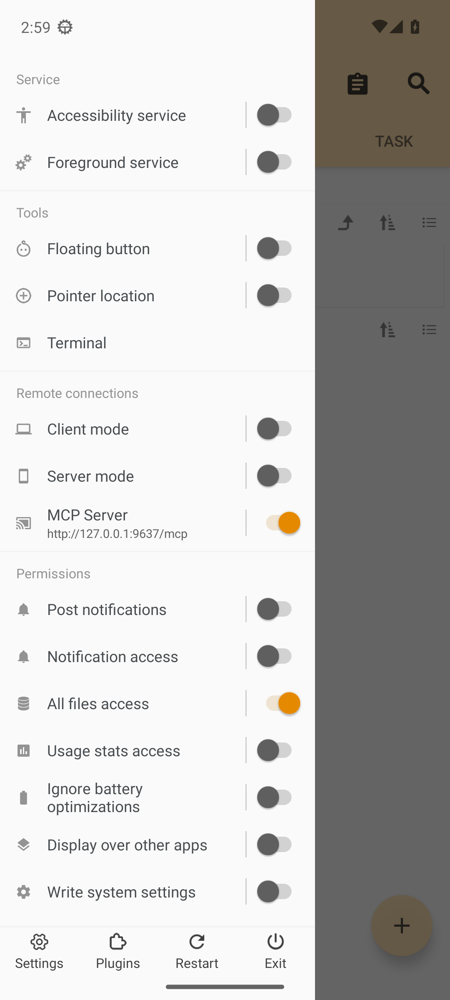
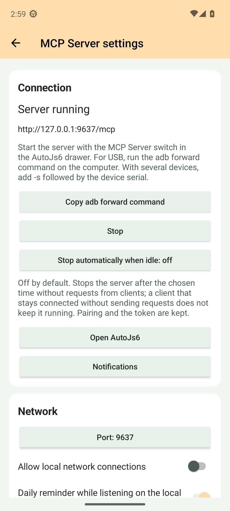

<!--suppress HtmlDeprecatedAttribute, HttpUrlsUsage -->

<div align="center">
  <p>
    <picture>
      <source srcset="https://github.com/SuperMonster003/AutoJs6-Plugin-MCP-Server/blob/master/app/src/main/res/mipmap-night/ic_launcher.png?raw=true" media="(prefers-color-scheme: dark)" />
      
    </picture>
  </p>

  <p>Expone la automatización del dispositivo a agentes de IA mediante el Model Context Protocol</p>

  <p>
    <a href="https://github.com/SuperMonster003/AutoJs6-Plugin-MCP-Server/releases"></a>
    <a href="https://github.com/SuperMonster003/AutoJs6-Plugin-MCP-Server/issues"></a>
    <a href="https://github.com/SuperMonster003/AutoJs6-Plugin-MCP-Server/blob/master/LICENSE"></a>
  </p>
</div>

******

### Idiomas

******

El README.md actual admite los siguientes idiomas:

- [简体中文 [zh-Hans]](https://github.com/SuperMonster003/AutoJs6-Plugin-MCP-Server/blob/master/.readme/README-zh-Hans.md)
- [繁體中文 (香港) [zh-Hant-HK]](https://github.com/SuperMonster003/AutoJs6-Plugin-MCP-Server/blob/master/.readme/README-zh-Hant-HK.md)
- [繁體中文 (台灣) [zh-Hant-TW]](https://github.com/SuperMonster003/AutoJs6-Plugin-MCP-Server/blob/master/.readme/README-zh-Hant-TW.md)
- [English [en]](https://github.com/SuperMonster003/AutoJs6-Plugin-MCP-Server/blob/master/.readme/README-en.md)
- [Français [fr]](https://github.com/SuperMonster003/AutoJs6-Plugin-MCP-Server/blob/master/.readme/README-fr.md)
- Español [es] # actual
- [日本語 [ja]](https://github.com/SuperMonster003/AutoJs6-Plugin-MCP-Server/blob/master/.readme/README-ja.md)
- [한국어 [ko]](https://github.com/SuperMonster003/AutoJs6-Plugin-MCP-Server/blob/master/.readme/README-ko.md)
- [Русский [ru]](https://github.com/SuperMonster003/AutoJs6-Plugin-MCP-Server/blob/master/.readme/README-ru.md)
- [العربية [ar]](https://github.com/SuperMonster003/AutoJs6-Plugin-MCP-Server/blob/master/.readme/README-ar.md)

******

### Introducción

******

MCP Server convierte un dispositivo Android con AutoJs6 en un servidor [Model Context Protocol](https://modelcontextprotocol.io). Los agentes de IA del PC, como Claude Code, Cursor o MCP Inspector, se conectan al teléfono por USB o Wi-Fi y usan herramientas para ejecutar scripts, leer registros, inspeccionar el árbol de nodos de accesibilidad, tocar y escribir, tomar capturas de pantalla y trabajar con archivos y aplicaciones.

El servidor se ejecuta dentro del propio proceso del plugin y se alcanza mediante un único punto de conexión Streamable HTTP. AutoJs6 entrega al plugin un intermediario de capacidades a través de Binder, de modo que cada llamada a una herramienta la ejecuta el anfitrión con sus permisos, motores y servicio de accesibilidad existentes; el plugin nunca duplica la funcionalidad del anfitrión.

******

### Estado

******

Versión 1.2.0: 37 herramientas (33 activadas por defecto), recursos y plantillas MCP, un interruptor en el panel de AutoJs6 y una página de ajustes del complemento. Requiere AutoJs6 6.8.0 (compilación 5298) o posterior; los recursos opcionales autojs6://docs/ necesitan además el plugin AutoJs6 Offline Docs y un anfitrión con sus métodos de retransmisión. El progreso y las evidencias se registran en [ROADMAP.md](https://github.com/SuperMonster003/AutoJs6-Plugin-MCP-Server/blob/master/ROADMAP.md).

******

### Funciones

******

El complemento ofrece las siguientes capacidades:

- Ajustes del teléfono para estado del servidor, USB, puerto y red local, token, revocación de vínculos, grupos y root, modo de desarrollador, configuraciones copiables (también como código QR) de Claude Code / Cursor / Codex / VS Code / HTTP e historial de versiones, siguiendo el aspecto de AutoJs6. Los cambios de red reinician el servidor activo; tokens y permisos se aplican inmediatamente. Los diálogos secretos bloquean capturas.
- Ejecución de scripts: ejecutar JavaScript desde texto o desde un archivo dentro de AutoJs6, listar y detener motores, y leer la salida reciente de la consola.
- Interfaz de accesibilidad: volcar el árbol de nodos en un formato de texto compacto, buscar nodos con la sintaxis de selectores de AutoJs6, hacer clic, mantener pulsado, desplazar, establecer texto y pulsar teclas globales como Atrás e Inicio.
- Grupo de capturas (P3.3): screen_capture devuelve imágenes MCP con recorte, scale o maxWidth, JPEG / PNG / WebP y control de calidad. Valores predeterminados: JPEG, calidad 70 y lado mayor de 1280 px. Si base64 supera 4 MiB, se reintenta con menor calidad o tamaño y los metadatos indican el ajuste. screen_state informa del estado, tamaño, orientación y densidad. El catálogo incluye 37 herramientas. La alternativa MediaProjection requiere AutoJs6 compilado el 2026-09-13 o después y autorización en el teléfono, reutilizada por la sesión del host. Con annotate: true se dibujan en la imagen las referencias #n del último ui_dump (un recuadro y una etiqueta por nodo), para relacionarlas con lo que hay en pantalla.
- Herramientas del directorio de trabajo (P3.4): files_list / stat / read / write / mkdir / rename / delete, editor_open con fila y columna desde 1, app_launch / list, clipboard_get / set, device_ensure_accessibility, toast y shell_exec. Lectura binaria en base64, hasta 1 MiB de datos originales. La escritura respeta además el límite del host (normalmente 96 KiB con escapes JSON). El borrado y Shell están desactivados inicialmente; root requiere allowShellRoot y el permiso shell.root del host. Se necesita el host P3.4 correspondiente.
- Los recursos MCP (P3.5) ofrecen archivos de trabajo de solo lectura, ejemplos del anfitrión, la documentación sin conexión cuando el plugin AutoJs6 Offline Docs está instalado, información del dispositivo y salida reciente de consola, respetando el emparejamiento y los grupos activos. Las lecturas de texto y datos binarios indican el truncamiento. Las plantillas write_autojs6_script, automate_task y debug_selector están disponibles en inglés y chino, con inglés para los demás idiomas del teléfono.
- Rutas de conexión: USB mediante `adb forward`, red local con activación explícita y un puente stdio en el PC para clientes sin transporte HTTP.
- Seguridad: un token bearer rotatorio, confirmación de emparejamiento en el teléfono en el primer uso e interruptores de herramientas por grupo; el servidor solo escucha en la interfaz de bucle local de forma predeterminada.

******

### Herramientas

******

La tabla siguiente se genera a partir de la instantánea del catálogo de herramientas del complemento (`app/src/test/resources/tool-catalog.snapshot.json`); las descripciones son los textos en inglés que reciben los clientes y cada grupo puede desactivarse en la página de ajustes:

| Herramienta | Grupo | Predeterminado | Descripción |
|---|---|---|---|
| `device_ping` | `device` | activado | Confirms that the AutoJs6 MCP Server plugin is reachable and returns its version, the device model, the Android API level, and the device time. |
| `device_info` | `device` | activado | Returns the device build, screen, battery, memory, AutoJs6 host version and process, accessibility service state, screen state, locale, and time zone as AutoJs6 reports them (schema autojs6-bridge-device-info-v1). No hardware identifiers. With AutoJs6 6.8.0 or later, plugins lists the plugin families (OCR, barcode, OpenCV, Pinyin, Pinyin4j, MediaInfo, offline docs) as available, not_installed, disabled or incompatible, the tools each brings and what to do in the AutoJs6 plugin center, so you can tell the user which plugin to install. |
| `script_run` | `script` | activado | Runs JavaScript source in AutoJs6 (its Rhino engine with the full AutoJs6 API) and by default waits for it to finish. Use it for automation steps: toasts, UI actions, file work, app launches. The result carries executionId, status (finished, error, running), durationMs, the exception with its line when the script threw, and the newest console lines. A script still running after the wait keeps running: script_stop stops it, script_list shows it, console_tail follows its output. |
| `script_run_file` | `script` | activado | Runs a script file that already exists on the device (AutoJs6 picks the engine from the suffix) and by default waits for it to finish. The result carries executionId, status (finished, error, running), durationMs, the exception with its line when the script threw, and the newest console lines. A script still running after the wait keeps running: script_stop stops it, script_list shows it, console_tail follows its output. |
| `script_stop` | `script` | activado | Stops one running AutoJs6 script by the executionId that script_run, script_run_file, or script_list reported. |
| `script_stop_all` | `script` | activado | Stops every script AutoJs6 is running, including ones started on the phone, and returns how many were stopped. |
| `script_list` | `script` | activado | Lists the scripts AutoJs6 is running or starting, with executionId, name, path, working directory, state, and uptime. |
| `console_tail` | `script` | activado | Returns the newest lines of the AutoJs6 console, which every script shares; optionally only entries after sinceId or at least a level. nextSinceId in the result continues from where this call ended. |
| `script_catalog` | `script` | activado | Lists the scripts the user registered for models in the AutoJs6 working directory (a script with an @agent JSDoc header, or a project with an agent object in project.json): id, path, description, parameter schema, the result it reports, risk (readonly, normal, sensitive), confirm (never, before-run) and timeout. query filters by id, description, tags and examples. Run one with script_registered_run; before running a script whose confirm is before-run or whose risk is sensitive, ask the user. Needs AutoJs6 6.8.0 or later. |
| `script_registered_run` | `script` | activado | Runs a script from script_catalog with arguments that AutoJs6 checks against the script's registered parameters (defaults filled in, unknown names refused), waits for it and stops it after its registered timeout (timeoutMs may only shorten it). Give id, or path when several scripts share an id. Returns the status (finished, error, stopped, timeout), the value the script reported with ai.agent.result, and the newest console lines. A registered script can act on the phone like script_run; ask the user first when its catalog entry says confirm before-run or risk sensitive. Needs AutoJs6 6.8.0 or later. |
| `ui_dump` | `ui` | activado | Dumps the accessibility node tree of the active window as compact text: one node per line with a #n reference, an indent per depth, the short class name, the state markers that apply (clickable, long_clickable, checkable, checked, scrollable, editable, focused, selected, !enabled, hidden), the text in quotes, desc=, id= (the full resource id), and the position (bounds [l,t][r,b] for a node with children, c=(x,y) for a leaf). Pass a #n reference as nodeRef to ui_click, ui_long_click, ui_set_text, or ui_scroll: AutoJs6 keeps the newest 8 dumps (snapshotId) and finds the node again when acting, so a reference works until the window changes or the node moves or changes. Call it before acting and again after the screen changed. format json returns the nodes as objects with every flag and format xml the uiautomator-style export; neither has references. |
| `ui_find` | `ui` | activado | Finds the nodes of the active window that match every condition of the selector, optionally waiting up to timeoutMs for the first match, and returns up to limit of them with bounds, center, and a selector that pins each node (pass it as selector to the action tools). An empty count is not an error; ui_explain_selector tells which condition fails. |
| `ui_current_window` | `ui` | activado | Returns the package and activity in the foreground, whether the AutoJs6 accessibility service is available, and the accessibility windows with their type, title, bounds, and focus. |
| `ui_explain_selector` | `ui` | activado | Explains why a selector matches or not: evaluates its conditions one by one over the active window and reports how many nodes pass each step cumulatively, the first failing condition, the matches, and the near misses. Use it when ui_find returns nothing. |
| `ui_wait_for` | `ui` | activado | Waits until a node matching the selector appears (default) or disappears, polling the active window every 0.5 s for up to timeoutMs, and answers TIMEOUT when the state is not reached; an appeared node comes with a selector that pins it. Use it after an action that opens a screen or dismisses a dialog. |
| `ui_click` | `ui` | activado | Clicks a node given by nodeRef (a #n reference from the last ui_dump), by selector (the first match in pre-order), or by x and y (a coordinate tap, allowed only while the ui_gesture group is enabled). The accessibility click climbs to the nearest clickable ancestor when the node itself is not clickable. Returns the node it acted on. Give nodeRef or selector, not both. |
| `ui_long_click` | `ui` | activado | Long-presses a node given by nodeRef or selector (the accessibility long click climbs to the nearest node that accepts it), or by x and y as a 700 ms press at that point (allowed only while the ui_gesture group is enabled). Give nodeRef or selector, not both. |
| `ui_set_text` | `ui` | activado | Sets the text of an editable node (an EditText, marked editable by ui_dump) given by nodeRef or selector; append adds to the current text instead of replacing it and needs a selector. Works without focus or the keyboard; ACTION_FAILED means the node is not editable or not enabled. Give nodeRef or selector, not both. |
| `ui_scroll` | `ui` | activado | Scrolls a node given by nodeRef or selector, or the first scrollable node of the window when neither is given: forward, down, and right move towards the end, backward, up, and left towards the start; times repeats the step. performed counts the steps the node accepted, fewer than requested means it reached the end. Give nodeRef or selector, not both. |
| `ui_press_key` | `ui` | activado | Presses a global key through the accessibility service: back, home, recents, notifications (opens the notification shade), quick_settings, power_dialog, or lock_screen (Android 9 or later). |
| `ui_swipe` | `ui_gesture` | desactivado | Swipes one finger from (x1, y1) to (x2, y2) in device pixels over durationMs; take the coordinates from ui_dump bounds or a screenshot. Part of the ui_gesture group, which is off by default. |
| `ui_gesture` | `ui_gesture` | desactivado | Performs a free-path one-finger gesture through the given points over durationMs (at most 10 s): the first point is the touch down, the last the lift. Part of the ui_gesture group, which is off by default. |
| `screen_capture` | `screen` | activado | Capture the phone screen as an MCP image with dimensions, size, duration and capture source. Uses accessibility on Android 11+ and falls back to MediaProjection, which requires consent on the phone the first time. Defaults to JPEG quality 70 and a longest edge of 1280 pixels. Choose scale or maxWidth to override the size. Images above the 4 MiB base64 limit are retried at lower quality or smaller dimensions; metadata reports adjustments. With annotate the #n references of the newest ui_dump are drawn on the image. At most 30 captures per minute per client; a RATE_LIMITED result names the wait in retryAfterMs. |
| `screen_state` | `screen` | activado | Read whether the screen is on, its current width and height, orientation, rotation, and density. Does not request screen capture consent. |
| `files_list` | `files` | activado | Lists workspace files with metadata. Results are bounded and report truncation. While "Allow reading shared storage" is switched on in the MCP Server settings on the phone, absolute paths in shared storage (such as /storage/emulated/0/DCIM/...) are accepted too, read-only; Android/data and Android/obb never are. A shared storage listing answers absolute paths and its root. |
| `files_stat` | `files` | activado | Returns existence, type, size, and modification time of a workspace path. While "Allow reading shared storage" is switched on in the MCP Server settings on the phone, absolute paths in shared storage (such as /storage/emulated/0/DCIM/...) are accepted too, read-only; Android/data and Android/obb never are. |
| `files_read` | `files` | activado | Reads up to 1 MiB. Use encoding base64 for binary data; encoding, bytes, totalBytes, and truncated identify the representation and limit. |
| `files_write` | `files` | activado | Writes UTF-8 text and refreshes the host explorer. Content is limited to 1 MiB and the negotiated Binder request budget (normally 96 KiB including JSON escaping); oversized calls fail before writing. |
| `files_mkdir` | `files` | activado | Creates a workspace directory and missing parents, then refreshes the host explorer. |
| `files_rename` | `files` | activado | Moves a workspace file or directory to another workspace path and refreshes the host explorer. |
| `files_delete` | `files_delete` | desactivado | Deletes a workspace entry. The separate files_delete group is off by default. The workspace root cannot be deleted. |
| `editor_open` | `files` | activado | Opens a workspace file in the AutoJs6 editor at a one-based line and column. Lines outside the file are ignored by the editor. |
| `app_launch` | `device` | activado | Opens an installed Android application. Provide exactly one of packageName or appName. |
| `app_list` | `device` | activado | Lists up to 1000 Android applications visible to AutoJs6, optionally matching a package name or label. Android package visibility restrictions apply. |
| `clipboard_get` | `device` | activado | Reads clipboard text (up to 64 KiB). Android may restrict clipboard access while AutoJs6 is in the background. |
| `clipboard_set` | `device` | activado | Replaces clipboard text, including an empty string to clear it. |
| `device_ensure_accessibility` | `device` | activado | Asks AutoJs6 to enable its accessibility service using its configured secure-settings, root, or Shizuku strategy. Waits up to 10 s for an operational service; failure includes manual activation guidance. |
| `toast` | `device` | activado | Shows a short Android toast on the phone. |
| `shell_exec` | `shell` | desactivado | Runs an Android shell command in the host workspace. The shell group is off by default; root also requires the separate allow root switch and a shell.root host grant. Reports exit code, timeout, stdout, stderr, and truncation. maxOutputBytes bounds stdout and stderr together. |
| `ocr_recognize` | `ocr` | activado | Recognize text on the phone screen or in an image file on the phone with an installed AutoJs6 OCR plugin (ML Kit, Paddle OCR or Rapid OCR). image is "screen" for the current screen, or a POSIX path relative to the AutoJs6 working directory for an image file. region crops before recognition, in screen pixels or file pixels. engine picks the OCR plugin; auto takes the first enabled one in ML Kit, Paddle, Rapid order. Returns the recognized lines as text and, as structured content, items with text, confidence and bounds (file bounds are in the file's own pixels even when AutoJs6 downscaled the image to read it). The screenshot is taken and recognized inside AutoJs6; no image leaves the phone. A first Paddle call loads its model and can take tens of seconds; timeoutMs defaults to 60 s. This tool exists only while an OCR plugin is installed and enabled in AutoJs6. While "Allow reading shared storage" is switched on in the MCP Server settings on the phone, absolute paths in shared storage (such as /storage/emulated/0/DCIM/...) are accepted too, read-only; Android/data and Android/obb never are. Reading the screen counts against the limit of 30 screenshots per minute per client that screen_capture also uses. |
| `barcode_detect` | `barcode` | activado | Detect barcodes and QR codes on the phone screen or in an image file on the phone with the AutoJs6 ML Kit Barcode plugin. image is "screen" for the current screen, or a POSIX path relative to the AutoJs6 working directory for an image file. formats limits the symbologies (all by default); region crops before detection, in screen pixels or file pixels. Returns one line per code (format and raw value) and, as structured content, items with rawValue, displayValue, format, valueType, bounds and cornerPoints (file coordinates are in the file's own pixels even when AutoJs6 downscaled the image to read it). The screenshot stays inside AutoJs6; no image leaves the phone. This tool exists only while the barcode plugin is installed and enabled in AutoJs6. While "Allow reading shared storage" is switched on in the MCP Server settings on the phone, absolute paths in shared storage (such as /storage/emulated/0/DCIM/...) are accepted too, read-only; Android/data and Android/obb never are. Reading the screen counts against the limit of 30 screenshots per minute per client that screen_capture also uses. |
| `opencv_find_image` | `opencv` | activado | Find where a smaller template image appears on the phone screen or in an image file on the phone (OpenCV template matching through the AutoJs6 OpenCV plugin). image is "screen" for the current screen, or a POSIX path relative to the AutoJs6 working directory; template is the path of the image to look for, at the same pixel scale as image (for the screen, cut from a full-resolution screenshot). threshold is the lowest similarity accepted (0..1); region limits the search, in screen pixels or file pixels; maxResults caps the matches, best first and without overlaps. Returns bounds, center and score of each match; screen coordinates are device pixels. This tool exists only while the OpenCV plugin is installed and enabled in AutoJs6. While "Allow reading shared storage" is switched on in the MCP Server settings on the phone, absolute paths in shared storage (such as /storage/emulated/0/DCIM/...) are accepted too, read-only; Android/data and Android/obb never are. Reading the screen counts against the limit of 30 screenshots per minute per client that screen_capture also uses. |
| `opencv_find_color` | `opencv` | activado | Find the first pixel of a color on the phone screen or in an image file on the phone (AutoJs6 OpenCV plugin). image is "screen" for the current screen, or a POSIX path relative to the AutoJs6 working directory. color is #RRGGBB or #RGB; threshold is the difference allowed in each of the red, green and blue channels; region limits the search, in screen pixels or file pixels. Pixels are searched row by row from the top left. Returns found and the point; screen coordinates are device pixels. This tool exists only while the OpenCV plugin is installed and enabled in AutoJs6. While "Allow reading shared storage" is switched on in the MCP Server settings on the phone, absolute paths in shared storage (such as /storage/emulated/0/DCIM/...) are accepted too, read-only; Android/data and Android/obb never are. Reading the screen counts against the limit of 30 screenshots per minute per client that screen_capture also uses. |
| `opencv_find_multi_colors` | `opencv` | activado | Find the first point whose color matches and whose neighbors at given offsets match their colors too (multi-point color search, AutoJs6 OpenCV plugin), on the phone screen or in an image file on the phone. image is "screen" for the current screen, or a POSIX path relative to the AutoJs6 working directory. color is the color of the point itself (#RRGGBB or #RGB); points lists the neighbors as {x, y, color}, with x and y relative to that point in the pixels of image. threshold is the difference allowed in each RGB channel for color and the average difference allowed for the neighbors; region limits where the point may lie. Returns found and the point; screen coordinates are device pixels. This tool exists only while the OpenCV plugin is installed and enabled in AutoJs6. While "Allow reading shared storage" is switched on in the MCP Server settings on the phone, absolute paths in shared storage (such as /storage/emulated/0/DCIM/...) are accepted too, read-only; Android/data and Android/obb never are. Reading the screen counts against the limit of 30 screenshots per minute per client that screen_capture also uses. |
| `pinyin_convert` | `pinyin` | activado | Convert Chinese text to Hanyu Pinyin with the AutoJs6 Pinyin plugin, which reads whole words from a phrase dictionary, so a character with several readings usually gets the one its word needs ("银行" -> yín háng); segment (on by default) splits longer text into words before the lookup. Readings come from the dictionary, so names and rare words can differ from usage. style picks the output (tone marks by default, tone2 / to3ne with digits, normal without tones, initials, first_letter); mode surname or place_name uses the readings of names; heteronym lists every reading of each character. Returns the pinyin as text, readings joined by spaces and alternatives by \|, and the rows as structured content. For other romanizations (Wade-Giles, Yale, ...) or the readings of single characters use pinyin4j_convert. This tool exists only while the Pinyin plugin is installed and enabled in AutoJs6. |
| `pinyin4j_convert` | `pinyin4j` | activado | Romanize Chinese text character by character with the AutoJs6 Pinyin4j plugin. Unlike pinyin_convert it looks at each character alone, without word context, so a character with several readings gets its first dictionary reading; in return it offers other romanizations (romanization: hanyu, tongyong, wade_giles, mps2, yale, gwoyeu) and, with allReadings, every reading of each character. For hanyu, tone chooses tone marks (default), tone numbers or none, and case lower or upper; other romanizations do not take tone or case. Returns the readings joined by separator (a space by default) as text, and one row per character as structured content. This tool exists only while the Pinyin4j plugin is installed and enabled in AutoJs6. |
| `mediainfo_read` | `mediainfo` | activado | Read the technical details and tags of an audio, video or image file on the phone with the AutoJs6 MediaInfo plugin: container format, duration, bit rates, codecs, resolution, frame rate, channels, sampling rate, title, artist and more. path is a POSIX path relative to the AutoJs6 working directory. Returns one summary line per track as text and every field of every track (general, video, audio, text, image, menu, other) as structured content; report adds the full MediaInfo text report. Values are MediaInfo's display strings ("5 min 3 s", "1 920 pixels"). This tool exists only while the MediaInfo plugin is installed and enabled in AutoJs6. While "Allow reading shared storage" is switched on in the MCP Server settings on the phone, absolute paths in shared storage (such as /storage/emulated/0/DCIM/...) are accepted too, read-only; Android/data and Android/obb never are. |

******

### Uso

******

1. Instale el APK del plugin desde [Releases](https://github.com/SuperMonster003/AutoJs6-Plugin-MCP-Server/releases) en un dispositivo con AutoJs6 build 5298 (6.8.0) o posterior.
2. Abra el centro de plugins de AutoJs6, confirme que `MCP Server` se reconoce y actívelo. Los paquetes oficiales superan la verificación de firma automáticamente.
3. Activa MCP Server en el panel de AutoJs6. Mantén pulsado su título o abre Ajustes desde el Centro de complementos. Copia la configuración del cliente de PC.
4. En el PC, ejecute `adb forward tcp:9637 tcp:9637` y apunte el cliente MCP a `http://127.0.0.1:9637/mcp` con el token como credencial bearer.
5. Confirma la primera solicitud de vinculación en el teléfono. Al terminar, detén el servidor desde el panel, los ajustes o la notificación.

> Interruptor MCP Server con guías de instalación, activación, autorización y compatibilidad; sincronización con Detener en la notificación; ajustes conservados al reconectar; acceso verificado a la misma página desde el panel y el Centro de complementos. Restaura el servidor al abrir AutoJs6 salvo que el usuario lo detuviera sin el anfitrión; no arranca con el dispositivo.

<p align="center">
  
  
</p>

******

### Configuración del cliente

******

Claude Code registra el servidor con un solo comando; los demás clientes usan la misma URL y cabecera en su configuración MCP:

```shell
adb forward tcp:9637 tcp:9637
claude mcp add --transport http autojs6 http://127.0.0.1:9637/mcp --header "Authorization: Bearer <token>"
```

Activa MCP Server en el panel de AutoJs6. Mantén pulsado su título o abre Ajustes desde el Centro de complementos. Copia la configuración del cliente de PC. Confirma la primera solicitud de vinculación en el teléfono. Al terminar, detén el servidor desde el panel, los ajustes o la notificación.

******

### Rutas de conexión

******

USB: `adb forward tcp:9637 tcp:9637` asigna el puerto del teléfono al PC; con varios dispositivos añade `-s <serial>` (consúltalo con `adb devices`), y los emuladores funcionan igual. Si el puerto está ocupado en cualquiera de los lados, cámbialo en la página de ajustes y reenvía el nuevo. La tarjeta de conexión ofrece el comando de reenvío listo para copiar.

Red local: activa "Permitir conexiones de red local" en la página de ajustes. La página muestra entonces las direcciones actuales del teléfono (siguen los cambios de Wi-Fi) y recuerda que el cliente debe estar en la misma red; las redes de invitados, el aislamiento del punto de acceso y el cortafuegos del PC son los bloqueos habituales. Las solicitudes de emparejamiento desde la red local se marcan como tales y una notificación diaria lo recuerda mientras el servidor siga accesible desde la red; el recordatorio puede desactivarse. En Android 17 o posterior, permita Dispositivos cercanos antes de activar este plugin en el centro de plugins de AutoJs6. También puede gestionar el permiso de red local en los ajustes del plugin. Sin permiso, el plugin permanece desactivado y el inicio automático se omite sin avisos. El permiso pertenece al plugin y es independiente del permiso de AutoJs6.

Ambas rutas usan el mismo token y el mismo emparejamiento en el teléfono. Los clientes sin transporte HTTP usan el puente stdio descrito en Clientes.

******

### Clientes

******

La página de ajustes copia una configuración lista con el token real para cada cliente de abajo; los fragmentos de aquí usan `<token>` como marcador. Todos los clientes hablan Streamable HTTP con una cabecera Authorization, y la primera llamada de un cliente nuevo se confirma en el teléfono. Verificados: Claude Code, Codex CLI, MCP Inspector, VS Code Copilot Chat, Cursor CLI y Claude Desktop (a través del puente); los demás clientes usan la misma URL y cabecera, pero el mantenedor aún no los ha probado.

Claude Code: ejecuta el comando mostrado en "Configuración del cliente" (la página de ajustes lo copia con el token); después `claude mcp list` muestra `autojs6` como Connected.

Cursor: añade la entrada de abajo a `mcp.json` (la CLI de Cursor, `cursor-agent`, lee el mismo `~/.cursor/mcp.json`):

```json
{
  "mcpServers": {
    "autojs6": {
      "url": "http://127.0.0.1:9637/mcp",
      "headers": {
        "Authorization": "Bearer <token>"
      }
    }
  }
}
```

VS Code (Copilot Chat): ejecuta el comando `MCP: Open User Configuration` e integra el contenido de abajo en el `mcp.json` que se abre; la clave superior es `servers`, no `mcpServers`, por lo que el fragmento JSON genérico no sirve tal cual. VS Code pide el token al iniciar el servidor por primera vez y lo guarda en su almacén de secretos en lugar del archivo (el botón Copiar token del diálogo "VS Code mcp.json" de la página de ajustes lo copia):

```json
{
  "inputs": [
    {
      "type": "promptString",
      "id": "autojs6-token",
      "description": "AutoJs6 MCP Server token",
      "password": true
    }
  ],
  "servers": {
    "autojs6": {
      "type": "http",
      "url": "http://127.0.0.1:9637/mcp",
      "headers": {
        "Authorization": "Bearer ${input:autojs6-token}"
      }
    }
  }
}
```

Codex CLI: pon el token en la variable de entorno `AUTOJS6_MCP_TOKEN` (la página de ajustes copia un comando de PowerShell para ello) y añade el servidor a `config.toml`, o ejecuta `codex mcp add autojs6 --url <url> --bearer-token-env-var AUTOJS6_MCP_TOKEN`:

```toml
[mcp_servers.autojs6]
url = "http://127.0.0.1:9637/mcp"
bearer_token_env_var = "AUTOJS6_MCP_TOKEN"
```

MCP Inspector: el modo CLI no necesita configuración adicional, y la interfaz web llega al teléfono a través de su propio proxy de Node. Activa el modo de desarrollador en la página de ajustes solo cuando una página del navegador se conecte directamente al endpoint:

```shell
npx @modelcontextprotocol/inspector --cli http://127.0.0.1:9637/mcp --transport http --header "Authorization: Bearer <token>" --method tools/list
```

Cline, Gemini CLI y clientes similares: usa la misma URL y cabecera en su configuración MCP; la página de ajustes ofrece un fragmento JSON genérico con `"type": "http"` (clave superior `mcpServers`).

Claude Desktop y otros clientes solo stdio: instala el puente con `npm install -g autojs6-mcp-bridge`, registra `autojs6-mcp-bridge --serial <serial>` como servidor stdio y pon `AUTOJS6_MCP_TOKEN` en su bloque de entorno (los fragmentos para Claude Desktop y Claude Code están en el [README del puente](https://github.com/SuperMonster003/AutoJs6-MCP-Bridge)). El puente 0.1.1 (Node.js 22 o posterior) funciona con el plugin 1.0.1 y posteriores, transmite la versión de protocolo del cliente sin cambios y abre una sesión nueva por sí mismo cuando el servidor del teléfono se reinicia (con 0.1.0, para Node.js 18 o posterior, había que reiniciar el servidor en el cliente); se verificó con Claude Code 2.1.257 y Claude Desktop 2.9939 por stdio. En Windows es más fiable ejecutar con `node` el `autojs6-mcp-bridge/dist/cli.js` instalado globalmente que iniciarlo con `npx`.

******

### Preguntas frecuentes

******

- 401 Unauthorized: el token falta, está mal escrito o fue rotado. Copia de nuevo la configuración desde la página de ajustes; tras Rotar token, cada cliente necesita el valor nuevo.
- VS Code muestra un aviso de OAuth o de registro de cliente: con un token incorrecto, VS Code intenta primero el descubrimiento OAuth y el registro dinámico de clientes, mientras que el plugin solo acepta su token estático. Cancela el aviso, borra el valor de entrada que VS Code guardó, vuelve a introducir el token y reinicia el servidor.
- Tiempo de emparejamiento agotado: la primera llamada de un cliente nuevo espera alrededor de un minuto a que pulses Permitir en el teléfono. Desbloquea el teléfono, acepta el diálogo o la acción de la notificación y repite la llamada. Denegar inicia un breve periodo de espera, tras el cual la siguiente llamada vuelve a preguntar.
- HOST_UNAVAILABLE: AutoJs6 no está en ejecución o su sesión de plugin está cerrada. Abre AutoJs6, mantén el interruptor del cajón activado y revisa el estado de conexión en la página de ajustes.
- Conexión rechazada (`ECONNREFUSED`): el interruptor del cajón está apagado o el `adb forward` del ordenador ya no existe. Reiniciar el servidor adb (al reconectar el dispositivo o cuando otra herramienta reinicia adb) borra todos los reenvíos; ejecuta de nuevo `adb -s <serial> forward tcp:9637 tcp:9637`, o deja que el puente cree el reenvío con `--serial` (lo elimina al salir).
- Accesibilidad desactivada: las herramientas `ui_*` y la captura de pantalla necesitan el servicio de accesibilidad de AutoJs6. Llama a `device_ensure_accessibility` o activa el servicio en los ajustes de accesibilidad del sistema.
- Puerto en uso: el cajón informa `port_in_use`. Cambia el puerto en la página de ajustes y reenvía el nuevo puerto con adb.
- Red local inaccesible: activa el acceso desde la red local, usa una dirección de las listadas en la página de ajustes, mantén el PC y el teléfono en la misma red sin aislamiento de invitados y permite el puerto en el cortafuegos del PC. El ahorro de energía Wi-Fi del teléfono añade unos cientos de milisegundos por llamada.
- El servidor desaparece al apagarse la pantalla: los teléfonos que restringen el uso de batería de la aplicación (HyperOS y MIUI lo hacen por defecto con aplicaciones instaladas manualmente) detienen el servicio en primer plano alrededor de un minuto después de apagarse la pantalla con batería. La página de ajustes muestra entonces un aviso con el botón "Ajustes de batería"; elija allí "Sin restricciones" para MCP Server. El ajuste opcional "Detener automáticamente en reposo" (desactivado por defecto) también detiene el servidor tras los minutos elegidos sin peticiones y deja una notificación que lo indica.
- La CLI de Cursor rechaza las llamadas a herramientas: `cursor-agent` solo ejecuta las herramientas de su lista de permitidos, así que en modo de impresión (`-p`) una herramienta MCP no permitida se rechaza localmente; la solicitud no llega al teléfono y no aparece ningún aviso de emparejamiento. Añade `Mcp(autojs6:<nombre de herramienta>)` por herramienta a `permissions.allow` en `~/.cursor/cli-config.json`, por ejemplo `Mcp(autojs6:device_info)`.

******

### Permisos y seguridad

******

El plugin sigue límites explícitos:

- Los puntos de entrada Binder y la página de ajustes están protegidos por el permiso de firma `org.autojs.permission.PLUGIN`, por lo que solo AutoJs6 puede alcanzarlos; el diálogo de emparejamiento, su receptor y la página de historial de versiones no están exportados. Solo el servicio en primer plano que aloja el receptor acepta adb (`android.permission.DUMP`), que es el interruptor de inicio / parada del desarrollador.
- El permiso INTERNET se usa solo para el propio receptor HTTP del plugin; el plugin no realiza solicitudes salientes ni recopila datos. El HTTP en claro solo se permite hacia direcciones de bucle local mediante la configuración de seguridad de red.
- El servidor escucha en 127.0.0.1 por defecto. El acceso desde la red local permanece desactivado hasta que lo active; el token, la confirmación de emparejamiento, la lista de Host permitidos y los límites de frecuencia siguen aplicándose en la red local, y una notificación diaria le recuerda que está activo.
- En Android 17 o posterior, permita Dispositivos cercanos antes de activar este plugin en el centro de plugins de AutoJs6. También puede gestionar el permiso de red local en los ajustes del plugin. Sin permiso, el plugin permanece desactivado y el inicio automático se omite sin avisos. El permiso pertenece al plugin y es independiente del permiso de AutoJs6.
- El token de acceso procede de una fuente aleatoria segura, se envuelve con una clave AES-GCM del Android Keystore y vive en el almacenamiento privado del plugin, que nunca se respalda; las copias de seguridad y las transferencias entre dispositivos están desactivadas. La página de ajustes muestra solo sus últimos 4 caracteres, los diálogos con el token completo bloquean las capturas de pantalla y las copias se marcan como sensibles en el portapapeles.
- Los registros nunca contienen el token, los cuerpos de las solicitudes, el contenido de archivos ni las capturas de pantalla; el plugin registra solo nombres de herramientas, nombres de clientes y huellas del token. Se verificó con logcat en dos dispositivos durante llamadas reales de archivos y capturas (docs/dev/p6-security-audit.md).
- Las llamadas a herramientas pasan por el intermediario de capacidades de AutoJs6 y nunca exceden lo que el propio anfitrión tiene permitido; los comandos de shell, la eliminación de archivos y los gestos permanecen desactivados hasta que active sus grupos, y un shell con root necesita además su propio interruptor y una concesión del anfitrión. La lectura del almacenamiento compartido (fotos, descargas, etc.) también está desactivada por defecto: solo con "Permitir leer el almacenamiento compartido" activado las herramientas de reconocimiento, multimedia y lista / propiedades leen allí rutas absolutas, solo en lectura y nunca bajo Android/data o Android/obb.
- Los emparejamientos se pueden revocar uno a uno o todos a la vez en la página de ajustes; un cliente revocado debe confirmarse de nuevo en el teléfono antes de su siguiente llamada a herramienta. Rotar el token conserva los emparejamientos pero corta a todo cliente que siga usando el token antiguo.

Obtenga el plugin únicamente desde la página oficial de [Releases](https://github.com/SuperMonster003/AutoJs6-Plugin-MCP-Server/releases) o el centro de plugins de AutoJs6. Los paquetes de origen desconocido pueden fallar la verificación del anfitrión o conllevar riesgos aunque el número de versión parezca idéntico.

******

### Interfaz del plugin

******

La siguiente información está dirigida a desarrolladores del anfitrión AutoJs6 y de plugins; el anfitrión usa estos identificadores para descubrir el plugin y negociar la compatibilidad:

```text
application id: io.github.supermonster003.autojs6.plugin.mcp.server
plugin id: mcp-server
engine: mcp-server
variant: default
service action: org.autojs.plugin.MCP_SERVER
service category: mcp-server
info action: org.autojs.plugin.INFO
aidl interface: org.autojs.plugin.mcp.server.api.IMcpServerPlugin
minimum host build: 5298 (6.8.0)
default endpoint: http://127.0.0.1:9637/mcp
```

`McpServerPluginService` implementa el contrato mcp-server-api del host `org.autojs.plugin.mcp.server.api.IMcpServerPlugin` en el proceso `:mcp_server` y responde a `org.autojs.plugin.MCP_SERVER` (category `mcp-server`). `McpServerPluginInfoService` responde a `org.autojs.plugin.INFO` con PluginInfo. `WakeActivity` permite al host activar el plugin.

******

### Hoja de ruta

******

Los planes y el progreso del plugin se mantienen como una lista verificable en ROADMAP.md, organizada por fases con criterios de aceptación y niveles de evidencia. Los elementos sin marcar expresan intención y no capacidades actuales; la discusión mediante Issues es bienvenida.

- [Ver ROADMAP.md](https://github.com/SuperMonster003/AutoJs6-Plugin-MCP-Server/blob/master/ROADMAP.md)

******

### Historial de versiones

******

#### v1.2.0

_2026/10/15_

- `Función` Seis grupos de herramientas de plugins con sus propios interruptores (reconocimiento de texto OCR, reconocimiento de códigos de barras, búsqueda de imágenes y colores OpenCV, conversión a pinyin Pinyin y Pinyin4j, metadatos multimedia MediaInfo): sus herramientas solo aparecen en la lista de herramientas del cliente mientras el plugin de AutoJs6 correspondiente está instalado y habilitado, la lista se actualiza sola al instalar, desinstalar o actualizar un plugin, y llamar a una herramienta cuyo plugin falta explica el motivo (PLUGIN_UNAVAILABLE); las llamadas de reconocimiento que leen la pantalla (image "screen") comparten con screen_capture el límite de 30 capturas por minuto y cliente, mientras que los archivos de imagen del teléfono no cuentan
- `Función` Herramienta ocr_recognize, que reconoce texto en la pantalla del teléfono o en un archivo de imagen del teléfono (necesita un plugin ML Kit, Paddle OCR o Rapid OCR instalado y habilitado): image "screen" captura y reconoce dentro de AutoJs6, una ruta dentro del directorio de trabajo lee primero el archivo; recorte region y elección de motor engine opcionales (automático por defecto); los resultados llevan texto, confianza y coordenadas (los archivos grandes en sus propios píxeles), y ninguna imagen sale del teléfono
- `Función` Herramienta barcode_detect, que lee códigos de barras y códigos QR en la pantalla del teléfono o en un archivo de imagen del teléfono (necesita un plugin ML Kit Barcode instalado y habilitado): image "screen" captura y detecta dentro de AutoJs6, una ruta dentro del directorio de trabajo lee primero el archivo; filtro de formatos formats, recorte region y límite maxResults opcionales; los resultados llevan el contenido, el formato y las coordenadas (los archivos grandes en sus propios píxeles), y ninguna imagen sale del teléfono
- `Función` Herramientas opencv_find_image, opencv_find_color y opencv_find_multi_colors, que buscan una imagen, un color o un patrón de colores de varios puntos en la pantalla del teléfono o en un archivo de imagen del teléfono (necesitan un plugin OpenCV instalado y habilitado): la plantilla de la búsqueda de imagen es una imagen del directorio de trabajo, y cada coincidencia trae sus límites, su centro y su similitud; las búsquedas de color devuelven el primer píxel que coincide; region limita cualquier búsqueda, y ninguna imagen sale del teléfono
- `Función` Herramientas pinyin_convert y pinyin4j_convert, que convierten texto chino a pinyin (necesitan un plugin Pinyin o Pinyin4j instalado y habilitado, respectivamente): pinyin_convert toma la lectura de palabras completas de un diccionario de frases, así que los caracteres con varias lecturas suelen salir bien, con estilos de tono, iniciales y un modo de apellidos / topónimos; pinyin4j_convert trabaja carácter por carácter y ofrece otras romanizaciones como Wade-Giles y Yale, marcas o números de tono, mayúsculas y todas las lecturas de cada carácter
- `Función` Herramienta mediainfo_read, que lee el formato, la duración, las tasas de bits, los códecs, la resolución, los canales, la frecuencia de muestreo y las etiquetas de un archivo de audio, vídeo o imagen del teléfono (necesita un plugin MediaInfo instalado y habilitado): la ruta es un archivo del directorio de trabajo, y el resultado trae un resumen y todos los campos de cada pista, con el informe de texto completo si se pide
- `Función` Interruptor "Permitir leer el almacenamiento compartido" en la página de ajustes (desactivado por defecto), que permite a las herramientas de reconocimiento, multimedia y lista / propiedades leer rutas absolutas del almacenamiento compartido, como fotos y descargas: hasta activarlo se rechazan las rutas absolutas, Android/data y Android/obb nunca se pueden leer y las demás herramientas de archivos siguen en el directorio de trabajo (AutoJs6 necesita el acceso a todos los archivos)
- `Función` Herramientas script_catalog y script_registered_run del grupo script, que listan y ejecutan los scripts que el usuario registró para los modelos en el directorio de trabajo de AutoJs6 (un script con un comentario de encabezado @agent, o un proyecto con una entrada agent en project.json; AutoJs6 6.8.0 o posterior): el catálogo muestra la descripción, los parámetros y el nivel de riesgo de cada script y si hay que preguntar antes; al ejecutar, AutoJs6 comprueba los argumentos según los parámetros registrados y completa los valores por defecto, detiene el script al agotar su tiempo registrado y devuelve el valor que informó el script y las últimas líneas de la consola; las herramientas solo aparecen cuando AutoJs6 las concede, y el modelo pide permiso al usuario antes de un script marcado como sensible o con confirmación previa
- `Corrección` Los scripts de pruebas en dispositivos iniciaban un APK de prueba de depuración residual contra la versión de lanzamiento y provocaban el cierre del proceso de la aplicación
- `Mejora` La herramienta device_info y el recurso autojs6://device/info ganan un campo plugins (AutoJs6 6.8.0 o posterior): el estado de cada familia de plugins, como OCR, códigos de barras, OpenCV, Pinyin, Pinyin4j, MediaInfo y documentación sin conexión (disponible / no instalado / desactivado / incompatible), las herramientas que aporta y una indicación de instalación, para que el modelo pueda decir al usuario qué instalar en el centro de plugins
- `Mejora` Con AutoJs6 6.8.0 compilación 5333 o posterior, el aviso de notificaciones desactivadas de la página de ajustes indica que las solicitudes de emparejamiento también aparecen mientras AutoJs6 está en primer plano

#### v1.1.0

_2026/10/11_

- `Aviso` Requiere AutoJs6 6.8.0 compilación 5298 o posterior (antes 5279), porque ahora AutoJs6 gestiona las referencias de nodos
- `Aviso` Cambio de comportamiento de las herramientas ui: ui_find y ui_wait_for devuelven un selector por nodo en lugar de una referencia #n, las formas json y xml de ui_dump no tienen referencias, append de ui_set_text necesita un selector y ui_dump muestra los identificadores de recurso completos
- `Corrección` La barra de estado de las páginas de ajustes e historial de versiones no tomaba el color del tema en Android 15 y posteriores (solo la barra de herramientas)
- `Corrección` Las solicitudes de emparejamiento desde un ordenador podían no aparecer en el teléfono en Android 14 y posteriores si las notificaciones no estaban permitidas (ahora la página de ajustes muestra la solicitud pendiente al abrirse e indica que las notificaciones están desactivadas)
- `Mejora` AutoJs6 se conecta al plugin mediante la interfaz de capacidades que comparte con sus otros plugins (contrato MCP versión 2)
- `Mejora` AutoJs6 conserva las referencias #n de ui_dump y vuelve a localizar el nodo al actuar: una referencia sigue valiendo mientras la ventana y el nodo no cambien (ya no caduca a los 60 s), los 8 volcados más recientes siguen disponibles mediante snapshotId y una referencia caducada indica el motivo
- `Dependencia` Archivos de la API de plugins de AutoJs6 actualizados a la compilación del anfitrión 6.8.0 / 5329, con `host-capability-api.aar` (módulo `plugin-api/host-capability-api` de AutoJs6, MPL 2.0) añadido; todos con el hash fijado en `locks/host-api-aars.lock`

#### v1.0.3

_2026/10/11_

- `Función` Fragmento VS Code mcp.json en la configuración de clientes de la página de ajustes: VS Code pide el token al iniciar el servidor por primera vez, por lo que el token no queda en el archivo (el diálogo incluye un botón "Copiar token")
- `Función` Los fragmentos de configuración de clientes y el diálogo del token en la página de ajustes pueden mostrar un código QR con el mismo texto que copia el botón "Copiar" (con el token cuando el texto lo incluye; la ventana bloquea capturas)
- `Función` La opción annotate de screen_capture, que dibuja en la imagen las referencias #n del último ui_dump / ui_find (recuadros y etiquetas); el campo annotation del resultado indica cuántas se dibujaron
- `Mejora` Flujos de eventos reanudables en el endpoint MCP con estado: los eventos llevan id, los clientes con protocolo 2025-11-25 o posterior reciben primero un evento de preparación con el intervalo de reconexión, y un flujo de solicitud interrumpido puede reanudarse con un GET que lleve Last-Event-ID, que reenvía los eventos perdidos y el resultado final (retención limitada por sesión)
- `Mejora` device_info, screen_state, script_run y script_run_file declaran un esquema de salida (outputSchema) con el que los clientes pueden validar sus resultados estructurados; los errores de estas herramientas llevan el código y el mensaje solo como texto
- `Mejora` Los iconos del centro de plugins usan los tamaños, posiciones, imágenes claras y oscuras y fondos circulares ajustados en Icon Studio, conservando fuentes y parámetros reproducibles
- `Mejora` Los iconos de información de la aplicación de Android comparten las imágenes y los fondos claros y oscuros de Icon Studio, conservando las imágenes transparentes del centro de plugins y las opciones del lanzador
- `Dependencia` ZXing Core 3.5.4 (`com.google.zxing:core`) añadido para dibujar los códigos QR de la página de ajustes (solo codificador, Apache 2.0)

##### Para más historial de versiones

* [CHANGELOG.md](https://github.com/SuperMonster003/AutoJs6-Plugin-MCP-Server/blob/master/app/src/main/assets/doc/CHANGELOG-es.md)

******

### Compilación y verificación

******

Esta sección está dirigida a desarrolladores que quieran compilar el plugin desde el código fuente; los usuarios normales pueden instalar simplemente el APK precompilado de la página Releases.

Compilar un APK de depuración:

```powershell
.\gradlew.bat :app:assembleDebug
```

Ejecutar las pruebas unitarias JVM y compilar el APK de pruebas de instrumentación:

```powershell
.\gradlew.bat :app:testDebugUnitTest :app:assembleDebugAndroidTest
```

Compilar el APK de release:

```powershell
.\gradlew.bat :app:assembleRelease
```

Recopilar el artefacto de release y añadir la versión y el resumen CRC32 a su nombre de archivo:

```powershell
.\gradlew.bat :app:appendDigestToReleasedFiles
```

Verificar que las fuentes de documentación multilingüe y los artefactos generados están sincronizados (también lo exige la CI):

```powershell
py .python\generate_markdown.py --check
```

La compilación requiere JDK 21 o posterior y Android SDK 37; las versiones de Gradle y de los plugins se gestionan de forma centralizada mediante `version.properties` e `io.github.supermonster003.autojs6-platform-versions`.

******

### Localización y generación de documentación

******

```text
.readme/common.json
.readme/lang_*.json
.readme/template_readme.md
.readme/template_plugin_instruction.md
.changelog/lang_*.json
.changelog/template_changelog.md
.python/generate_markdown.py
app/src/main/assets/doc/CHANGELOG-*.md
app/src/main/res/raw-*/plugin_instruction.md
```

Los archivos JSON de idioma en `.readme/` y `.changelog/` son la única fuente del README, las instrucciones del centro de plugins y el registro de cambios. Edite siempre esas fuentes JSON y vuelva a ejecutar `py .python/generate_markdown.py`; los artefactos generados de README, `plugin_instruction.md` y registro de cambios nunca se editan a mano. Ejecute `py .python/generate_markdown.py --check` para verificar todos los artefactos generados.

******

### Licencia

******

El código del proyecto se distribuye bajo la [Mozilla Public License 2.0](https://github.com/SuperMonster003/AutoJs6-Plugin-MCP-Server/blob/master/LICENSE). Los componentes de terceros y sus licencias se listan en los [Avisos de terceros](https://github.com/SuperMonster003/AutoJs6-Plugin-MCP-Server/blob/master/THIRD_PARTY_NOTICES.md).

******

### Enlaces

******

- Proyecto AutoJs6: https://github.com/SuperMonster003/AutoJs6
- Documentación de AutoJs6: https://docs.autojs6.com
- Especificación del Model Context Protocol: https://modelcontextprotocol.io
- Avisos de terceros: https://github.com/SuperMonster003/AutoJs6-Plugin-MCP-Server/blob/master/THIRD_PARTY_NOTICES.md


[16 KB page alignment and build verification](https://github.com/SuperMonster003/AutoJs6-Plugin-MCP-Server/blob/master/docs/16kb.md)
