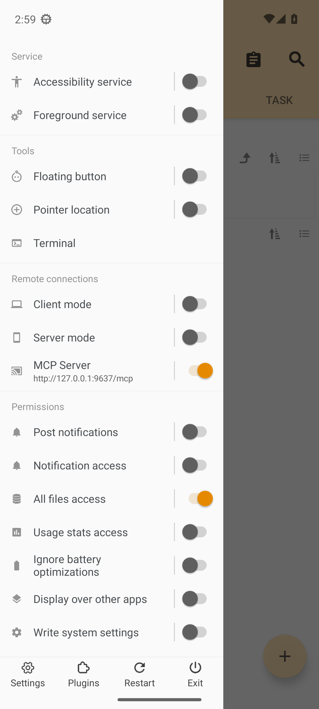
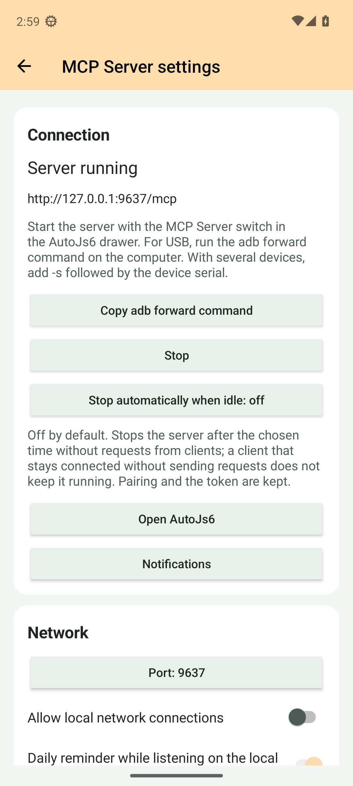

<!--suppress HtmlDeprecatedAttribute, HttpUrlsUsage -->

<div align="center">
  <p>
    <picture>
      <source srcset="https://github.com/SuperMonster003/AutoJs6-Plugin-MCP-Server/blob/master/app/src/main/res/mipmap-night/ic_launcher.png?raw=true" media="(prefers-color-scheme: dark)" />
      
    </picture>
  </p>

  <p>Expose l'automatisation de l'appareil aux agents IA via le Model Context Protocol</p>

  <p>
    <a href="https://github.com/SuperMonster003/AutoJs6-Plugin-MCP-Server/releases"></a>
    <a href="https://github.com/SuperMonster003/AutoJs6-Plugin-MCP-Server/issues"></a>
    <a href="https://github.com/SuperMonster003/AutoJs6-Plugin-MCP-Server/blob/master/LICENSE"></a>
  </p>
</div>

******

### Langues

******

Le README.md actuel prend en charge les langues suivantes:

- [简体中文 [zh-Hans]](https://github.com/SuperMonster003/AutoJs6-Plugin-MCP-Server/blob/master/.readme/README-zh-Hans.md)
- [繁體中文 (香港) [zh-Hant-HK]](https://github.com/SuperMonster003/AutoJs6-Plugin-MCP-Server/blob/master/.readme/README-zh-Hant-HK.md)
- [繁體中文 (台灣) [zh-Hant-TW]](https://github.com/SuperMonster003/AutoJs6-Plugin-MCP-Server/blob/master/.readme/README-zh-Hant-TW.md)
- [English [en]](https://github.com/SuperMonster003/AutoJs6-Plugin-MCP-Server/blob/master/.readme/README-en.md)
- Français [fr] # actuel
- [Español [es]](https://github.com/SuperMonster003/AutoJs6-Plugin-MCP-Server/blob/master/.readme/README-es.md)
- [日本語 [ja]](https://github.com/SuperMonster003/AutoJs6-Plugin-MCP-Server/blob/master/.readme/README-ja.md)
- [한국어 [ko]](https://github.com/SuperMonster003/AutoJs6-Plugin-MCP-Server/blob/master/.readme/README-ko.md)
- [Русский [ru]](https://github.com/SuperMonster003/AutoJs6-Plugin-MCP-Server/blob/master/.readme/README-ru.md)
- [العربية [ar]](https://github.com/SuperMonster003/AutoJs6-Plugin-MCP-Server/blob/master/.readme/README-ar.md)

******

### Introduction

******

MCP Server transforme un appareil Android exécutant AutoJs6 en serveur [Model Context Protocol](https://modelcontextprotocol.io). Les agents IA sur PC, tels que Claude Code, Cursor ou MCP Inspector, se connectent au téléphone par USB ou Wi-Fi et utilisent des outils pour exécuter des scripts, lire les journaux, inspecter l'arbre des noeuds d'accessibilité, toucher et saisir du texte, prendre des captures d'écran et manipuler des fichiers et des applications. Avec les plugins AutoJs6 correspondants installés, ils peuvent aussi lire du texte et des codes-barres à l'écran ou dans des images, rechercher des images et des couleurs, convertir le chinois en pinyin et lire les informations des médias. Les plugins peuvent aussi décrire leurs propres outils (par exemple la conversion entre chinois simplifié et traditionnel), que MCP Server propose en un groupe par plugin.

Le serveur s'exécute dans le processus propre du plugin et est joignable via un unique point de terminaison Streamable HTTP. AutoJs6 fournit au plugin un courtier de capacités via Binder, de sorte que chaque appel d'outil est exécuté par l'hôte avec ses permissions, ses moteurs et son service d'accessibilité existants ; le plugin ne duplique jamais les fonctionnalités de l'hôte.

******

### État

******

Version 1.2.0: 39 outils intégrés (35 activés par défaut) et 8 outils de capacités des plugins, ressources et invites MCP, un bouton dans le volet AutoJs6 et une page de paramètres du plugin. Nécessite AutoJs6 6.8.0 (build 5298) ou plus récent; les outils de capacités des plugins n'apparaissent que lorsque le plugin AutoJs6 correspondant est installé et activé, ceux-ci et les outils de scripts enregistrés restent masqués sur les hôtes qui ne les prennent pas en charge, et les ressources optionnelles autojs6://docs/ demandent aussi le plugin AutoJs6 Offline Docs et un hôte doté de ses méthodes de relais. Les outils que les plugins AutoJs6 décrivent eux-mêmes (comme opencc_convert de 3-Hanzi CC) sont listés en plus, un groupe par plugin, avec AutoJs6 6.8.0 ou ultérieur. L'avancement et les preuves sont consignés dans [ROADMAP.md](https://github.com/SuperMonster003/AutoJs6-Plugin-MCP-Server/blob/master/ROADMAP.md).

******

### Fonctionnalités

******

Le plugin fournit les capacités suivantes:

- Paramètres du téléphone pour l'état, USB, le port et le réseau local, les jetons, la révocation des associations, les groupes et root, le mode développeur, les configurations copiables (aussi en code QR) Claude Code / Cursor / Codex / VS Code / HTTP et l'historique, avec l'apparence AutoJs6. Les changements réseau redémarrent le serveur actif; jetons et autorisations prennent effet immédiatement. Les fenêtres secrètes bloquent les captures.
- Exécution de scripts : exécuter du JavaScript depuis un texte ou un fichier dans AutoJs6, lister et arrêter les moteurs, et lire la sortie récente de la console.
- Interface d'accessibilité : exporter l'arbre des noeuds dans un format texte compact, trouver des noeuds avec la syntaxe de sélecteur d'AutoJs6, cliquer, appuyer longuement, faire défiler, saisir du texte et déclencher des touches globales comme Retour et Accueil.
- Groupe de capture (P3.3): screen_capture renvoie des images MCP avec recadrage, scale ou maxWidth, JPEG / PNG / WebP et qualité réglable. Valeurs par défaut: JPEG, qualité 70, côté le plus long de 1280 px. Au-delà de 4 MiB de base64, la qualité ou les dimensions diminuent et les métadonnées indiquent les ajustements. screen_state fournit l'état, les dimensions, l'orientation et la densité. Le repli MediaProjection nécessite AutoJs6 compilé le 2026-09-13 ou après et un accord sur le téléphone, réutilisé par la session hôte. Avec annotate: true, les références #n du dernier ui_dump sont dessinées sur l'image (un cadre et une étiquette par nœud), pour les rapprocher de ce qui est à l'écran.
- Outils du répertoire de travail (P3.4): files_list / stat / read / write / mkdir / rename / delete, editor_open avec ligne et colonne à partir de 1, app_launch / list, clipboard_get / set, device_ensure_accessibility, toast et shell_exec. Lecture binaire en base64, au plus 1 MiB de données brutes. Les écritures respectent aussi le budget du host (normalement 96 KiB avec les échappements JSON). Suppression et Shell sont désactivés par défaut; root exige allowShellRoot et une autorisation shell.root du host. La version P3.4 correspondante du host est nécessaire.
- Les ressources MCP (P3.5) donnent accès en lecture seule aux fichiers de travail, aux exemples du serveur hôte, à la documentation hors ligne lorsque le plugin AutoJs6 Offline Docs est installé, aux informations de l'appareil et à la console récente, selon l'appairage et les groupes actifs. Les lectures de texte et de données binaires signalent toute troncature. Les modèles write_autojs6_script, automate_task et debug_selector proposent des instructions en anglais et en chinois, avec repli en anglais pour les autres langues du téléphone.
- Outils de capacités des plugins: reconnaissance de texte OCR, reconnaissance de codes-barres, recherche d'images et de couleurs OpenCV, conversion en pinyin Pinyin et Pinyin4j, métadonnées MediaInfo. Chaque outil n'apparaît que lorsque le plugin AutoJs6 correspondant est installé et activé, et les clients sont avertis quand un plugin est installé, supprimé ou désactivé. La reconnaissance fonctionne sur l'écran (image "screen", qui partage avec screen_capture la limite de 30 captures par minute) ou sur des images du répertoire de travail, et les images ne quittent jamais le téléphone; avec "Autoriser la lecture du stockage partagé" activé, les fichiers des photos, des téléchargements et d'autres emplacements sont aussi lisibles. device_info indique l'état de chaque famille de plugins avec une astuce d'installation.
- Scripts enregistrés: script_catalog liste les scripts que vous avez enregistrés pour les modèles avec un commentaire @agent ou dans project.json (description, paramètres, niveau de risque, s'il faut demander avant), et script_registered_run en exécute un avec des arguments vérifiés selon ses paramètres enregistrés et renvoie la valeur signalée par le script. Le risque et la confirmation sont transmis au client, qui vous demande votre accord avant d'exécuter un tel script.
- Outils décrits par les plugins: les outils que déclarent les plugins AutoJs6 (nom, description, format des arguments et niveau de risque rédigés par l'auteur du plugin, par exemple opencc_convert de 3-Hanzi CC) apparaissent dans la liste des outils en un groupe par plugin, et AutoJs6 vérifie les arguments selon le format déclaré. Dans "Outils des plugins" des réglages, les plugins officiels sont activés par défaut, les plugins tiers doivent d'abord être autorisés dans le centre de plugins d'AutoJs6 puis activés à la main; les outils qui écrivent, suppriment ou accèdent au réseau demandent aussi le second interrupteur de leur groupe. Les arguments image acceptent "screen" (limite de captures partagée avec screen_capture) ou un chemin; les fichiers produits par un outil sont écrits dans plugin-outputs du répertoire de travail et leurs chemins sont renvoyés (outputPaths choisit l'emplacement et ne remplace jamais un fichier existant), avec un aperçu pour les images jusqu'à 1 MiB; le champ pluginTools de device_info montre l'état et les interrupteurs de chaque plugin.
- Chemins de connexion : USB via `adb forward`, réseau local avec activation explicite et pont stdio côté PC pour les clients sans transport HTTP.
- Sécurité : jeton bearer renouvelable, confirmation d'appairage à la première utilisation sur le téléphone et interrupteurs d'outils par groupe ; le serveur n'écoute par défaut que sur l'interface de bouclage.

******

### Outils

******

Le tableau ci-dessous est généré à partir de l'instantané du catalogue d'outils du plugin (`app/src/test/resources/tool-catalog.snapshot.json`); les descriptions sont les textes anglais reçus par les clients et chaque groupe peut être désactivé depuis la page de paramètres:

| Outil | Groupe | Par défaut | Description |
|---|---|---|---|
| `device_ping` | `device` | activé | Confirms that the AutoJs6 MCP Server plugin is reachable and returns its version, the device model, the Android API level, and the device time. |
| `device_info` | `device` | activé | Returns the device build, screen, battery, memory, AutoJs6 host version and process, accessibility service state, screen state, locale, and time zone as AutoJs6 reports them (schema autojs6-bridge-device-info-v1). No hardware identifiers. With AutoJs6 6.8.0 or later, plugins lists the plugin families (OCR, barcode, OpenCV, Pinyin, Pinyin4j, MediaInfo, offline docs) as available, not_installed, disabled or incompatible, the tools each brings and what to do in the AutoJs6 plugin center, so you can tell the user which plugin to install. |
| `script_run` | `script` | activé | Runs JavaScript source in AutoJs6 (its Rhino engine with the full AutoJs6 API) and by default waits for it to finish. Use it for automation steps: toasts, UI actions, file work, app launches. The result carries executionId, status (finished, error, running), durationMs, the exception with its line when the script threw, and the newest console lines. A script still running after the wait keeps running: script_stop stops it, script_list shows it, console_tail follows its output. |
| `script_run_file` | `script` | activé | Runs a script file that already exists on the device (AutoJs6 picks the engine from the suffix) and by default waits for it to finish. The result carries executionId, status (finished, error, running), durationMs, the exception with its line when the script threw, and the newest console lines. A script still running after the wait keeps running: script_stop stops it, script_list shows it, console_tail follows its output. |
| `script_stop` | `script` | activé | Stops one running AutoJs6 script by the executionId that script_run, script_run_file, or script_list reported. |
| `script_stop_all` | `script` | activé | Stops every script AutoJs6 is running, including ones started on the phone, and returns how many were stopped. |
| `script_list` | `script` | activé | Lists the scripts AutoJs6 is running or starting, with executionId, name, path, working directory, state, and uptime. |
| `console_tail` | `script` | activé | Returns the newest lines of the AutoJs6 console, which every script shares; optionally only entries after sinceId or at least a level. nextSinceId in the result continues from where this call ended. |
| `script_catalog` | `script` | activé | Lists the scripts the user registered for models in the AutoJs6 working directory (a script with an @agent JSDoc header, or a project with an agent object in project.json): id, path, description, parameter schema, the result it reports, risk (readonly, normal, sensitive), confirm (never, before-run) and timeout. query filters by id, description, tags and examples. Run one with script_registered_run; before running a script whose confirm is before-run or whose risk is sensitive, ask the user. Needs AutoJs6 6.8.0 or later. |
| `script_registered_run` | `script` | activé | Runs a script from script_catalog with arguments that AutoJs6 checks against the script's registered parameters (defaults filled in, unknown names refused), waits for it and stops it after its registered timeout (timeoutMs may only shorten it). Give id, or path when several scripts share an id. Returns the status (finished, error, stopped, timeout), the value the script reported with ai.agent.result, and the newest console lines. A registered script can act on the phone like script_run; ask the user first when its catalog entry says confirm before-run or risk sensitive. Needs AutoJs6 6.8.0 or later. |
| `ui_dump` | `ui` | activé | Dumps the accessibility node tree of the active window as compact text: one node per line with a #n reference, an indent per depth, the short class name, the state markers that apply (clickable, long_clickable, checkable, checked, scrollable, editable, focused, selected, !enabled, hidden), the text in quotes, desc=, id= (the full resource id), and the position (bounds [l,t][r,b] for a node with children, c=(x,y) for a leaf). Pass a #n reference as nodeRef to ui_click, ui_long_click, ui_set_text, or ui_scroll: AutoJs6 keeps the newest 8 dumps (snapshotId) and finds the node again when acting, so a reference works until the window changes or the node moves or changes. Call it before acting and again after the screen changed. format json returns the nodes as objects with every flag and format xml the uiautomator-style export; neither has references. |
| `ui_find` | `ui` | activé | Finds the nodes of the active window that match every condition of the selector, optionally waiting up to timeoutMs for the first match, and returns up to limit of them with bounds, center, and a selector that pins each node (pass it as selector to the action tools). An empty count is not an error; ui_explain_selector tells which condition fails. |
| `ui_current_window` | `ui` | activé | Returns the package and activity in the foreground, whether the AutoJs6 accessibility service is available, and the accessibility windows with their type, title, bounds, and focus. |
| `ui_explain_selector` | `ui` | activé | Explains why a selector matches or not: evaluates its conditions one by one over the active window and reports how many nodes pass each step cumulatively, the first failing condition, the matches, and the near misses. Use it when ui_find returns nothing. |
| `ui_wait_for` | `ui` | activé | Waits until a node matching the selector appears (default) or disappears, polling the active window every 0.5 s for up to timeoutMs, and answers TIMEOUT when the state is not reached; an appeared node comes with a selector that pins it. Use it after an action that opens a screen or dismisses a dialog. |
| `ui_click` | `ui` | activé | Clicks a node given by nodeRef (a #n reference from the last ui_dump), by selector (the first match in pre-order), or by x and y (a coordinate tap, allowed only while the ui_gesture group is enabled). The accessibility click climbs to the nearest clickable ancestor when the node itself is not clickable. Returns the node it acted on. Give nodeRef or selector, not both. |
| `ui_long_click` | `ui` | activé | Long-presses a node given by nodeRef or selector (the accessibility long click climbs to the nearest node that accepts it), or by x and y as a 700 ms press at that point (allowed only while the ui_gesture group is enabled). Give nodeRef or selector, not both. |
| `ui_set_text` | `ui` | activé | Sets the text of an editable node (an EditText, marked editable by ui_dump) given by nodeRef or selector; append adds to the current text instead of replacing it and needs a selector. Works without focus or the keyboard; ACTION_FAILED means the node is not editable or not enabled. Give nodeRef or selector, not both. |
| `ui_scroll` | `ui` | activé | Scrolls a node given by nodeRef or selector, or the first scrollable node of the window when neither is given: forward, down, and right move towards the end, backward, up, and left towards the start; times repeats the step. performed counts the steps the node accepted, fewer than requested means it reached the end. Give nodeRef or selector, not both. |
| `ui_press_key` | `ui` | activé | Presses a global key through the accessibility service: back, home, recents, notifications (opens the notification shade), quick_settings, power_dialog, or lock_screen (Android 9 or later). |
| `ui_swipe` | `ui_gesture` | désactivé | Swipes one finger from (x1, y1) to (x2, y2) in device pixels over durationMs; take the coordinates from ui_dump bounds or a screenshot. Part of the ui_gesture group, which is off by default. |
| `ui_gesture` | `ui_gesture` | désactivé | Performs a free-path one-finger gesture through the given points over durationMs (at most 10 s): the first point is the touch down, the last the lift. Part of the ui_gesture group, which is off by default. |
| `screen_capture` | `screen` | activé | Capture the phone screen as an MCP image with dimensions, size, duration and capture source. Uses accessibility on Android 11+ and falls back to MediaProjection, which requires consent on the phone the first time. Defaults to JPEG quality 70 and a longest edge of 1280 pixels. Choose scale or maxWidth to override the size. Images above the 4 MiB base64 limit are retried at lower quality or smaller dimensions; metadata reports adjustments. With annotate the #n references of the newest ui_dump are drawn on the image. At most 30 captures per minute per client; a RATE_LIMITED result names the wait in retryAfterMs. |
| `screen_state` | `screen` | activé | Read whether the screen is on, its current width and height, orientation, rotation, and density. Does not request screen capture consent. |
| `files_list` | `files` | activé | Lists workspace files with metadata. Results are bounded and report truncation. While "Allow reading shared storage" is switched on in the MCP Server settings on the phone, absolute paths in shared storage (such as /storage/emulated/0/DCIM/...) are accepted too, read-only; Android/data and Android/obb never are. A shared storage listing answers absolute paths and its root. |
| `files_stat` | `files` | activé | Returns existence, type, size, and modification time of a workspace path. While "Allow reading shared storage" is switched on in the MCP Server settings on the phone, absolute paths in shared storage (such as /storage/emulated/0/DCIM/...) are accepted too, read-only; Android/data and Android/obb never are. |
| `files_read` | `files` | activé | Reads up to 1 MiB. Use encoding base64 for binary data; encoding, bytes, totalBytes, and truncated identify the representation and limit. |
| `files_write` | `files` | activé | Writes UTF-8 text and refreshes the host explorer. Content is limited to 1 MiB and the negotiated Binder request budget (normally 96 KiB including JSON escaping); oversized calls fail before writing. |
| `files_mkdir` | `files` | activé | Creates a workspace directory and missing parents, then refreshes the host explorer. |
| `files_rename` | `files` | activé | Moves a workspace file or directory to another workspace path and refreshes the host explorer. |
| `files_delete` | `files_delete` | désactivé | Deletes a workspace entry. The separate files_delete group is off by default. The workspace root cannot be deleted. |
| `editor_open` | `files` | activé | Opens a workspace file in the AutoJs6 editor at a one-based line and column. Lines outside the file are ignored by the editor. |
| `app_launch` | `device` | activé | Opens an installed Android application. Provide exactly one of packageName or appName. |
| `app_list` | `device` | activé | Lists up to 1000 Android applications visible to AutoJs6, optionally matching a package name or label. Android package visibility restrictions apply. |
| `clipboard_get` | `device` | activé | Reads clipboard text (up to 64 KiB). Android may restrict clipboard access while AutoJs6 is in the background. |
| `clipboard_set` | `device` | activé | Replaces clipboard text, including an empty string to clear it. |
| `device_ensure_accessibility` | `device` | activé | Asks AutoJs6 to enable its accessibility service using its configured secure-settings, root, or Shizuku strategy. Waits up to 10 s for an operational service; failure includes manual activation guidance. |
| `toast` | `device` | activé | Shows a short Android toast on the phone. |
| `shell_exec` | `shell` | désactivé | Runs an Android shell command in the host workspace. The shell group is off by default; root also requires the separate allow root switch and a shell.root host grant. Reports exit code, timeout, stdout, stderr, and truncation. maxOutputBytes bounds stdout and stderr together. |
| `ocr_recognize` | `ocr` | activé | Recognize text on the phone screen or in an image file on the phone with an installed AutoJs6 OCR plugin (ML Kit, Paddle OCR or Rapid OCR). image is "screen" for the current screen, or a POSIX path relative to the AutoJs6 working directory for an image file. region crops before recognition, in screen pixels or file pixels. engine picks the OCR plugin; auto takes the first enabled one in ML Kit, Paddle, Rapid order. Returns the recognized lines as text and, as structured content, items with text, confidence and bounds (file bounds are in the file's own pixels even when AutoJs6 downscaled the image to read it). The screenshot is taken and recognized inside AutoJs6; no image leaves the phone. A first Paddle call loads its model and can take tens of seconds; timeoutMs defaults to 60 s. This tool exists only while an OCR plugin is installed and enabled in AutoJs6. While "Allow reading shared storage" is switched on in the MCP Server settings on the phone, absolute paths in shared storage (such as /storage/emulated/0/DCIM/...) are accepted too, read-only; Android/data and Android/obb never are. Reading the screen counts against the limit of 30 screenshots per minute per client that screen_capture also uses. |
| `barcode_detect` | `barcode` | activé | Detect barcodes and QR codes on the phone screen or in an image file on the phone with the AutoJs6 ML Kit Barcode plugin. image is "screen" for the current screen, or a POSIX path relative to the AutoJs6 working directory for an image file. formats limits the symbologies (all by default); region crops before detection, in screen pixels or file pixels. Returns one line per code (format and raw value) and, as structured content, items with rawValue, displayValue, format, valueType, bounds and cornerPoints (file coordinates are in the file's own pixels even when AutoJs6 downscaled the image to read it). The screenshot stays inside AutoJs6; no image leaves the phone. This tool exists only while the barcode plugin is installed and enabled in AutoJs6. While "Allow reading shared storage" is switched on in the MCP Server settings on the phone, absolute paths in shared storage (such as /storage/emulated/0/DCIM/...) are accepted too, read-only; Android/data and Android/obb never are. Reading the screen counts against the limit of 30 screenshots per minute per client that screen_capture also uses. |
| `opencv_find_image` | `opencv` | activé | Find where a smaller template image appears on the phone screen or in an image file on the phone (OpenCV template matching through the AutoJs6 OpenCV plugin). image is "screen" for the current screen, or a POSIX path relative to the AutoJs6 working directory; template is the path of the image to look for, at the same pixel scale as image (for the screen, cut from a full-resolution screenshot). threshold is the lowest similarity accepted (0..1); region limits the search, in screen pixels or file pixels; maxResults caps the matches, best first and without overlaps. Returns bounds, center and score of each match; screen coordinates are device pixels. This tool exists only while the OpenCV plugin is installed and enabled in AutoJs6. While "Allow reading shared storage" is switched on in the MCP Server settings on the phone, absolute paths in shared storage (such as /storage/emulated/0/DCIM/...) are accepted too, read-only; Android/data and Android/obb never are. Reading the screen counts against the limit of 30 screenshots per minute per client that screen_capture also uses. |
| `opencv_find_color` | `opencv` | activé | Find the first pixel of a color on the phone screen or in an image file on the phone (AutoJs6 OpenCV plugin). image is "screen" for the current screen, or a POSIX path relative to the AutoJs6 working directory. color is #RRGGBB or #RGB; threshold is the difference allowed in each of the red, green and blue channels; region limits the search, in screen pixels or file pixels. Pixels are searched row by row from the top left. Returns found and the point; screen coordinates are device pixels. This tool exists only while the OpenCV plugin is installed and enabled in AutoJs6. While "Allow reading shared storage" is switched on in the MCP Server settings on the phone, absolute paths in shared storage (such as /storage/emulated/0/DCIM/...) are accepted too, read-only; Android/data and Android/obb never are. Reading the screen counts against the limit of 30 screenshots per minute per client that screen_capture also uses. |
| `opencv_find_multi_colors` | `opencv` | activé | Find the first point whose color matches and whose neighbors at given offsets match their colors too (multi-point color search, AutoJs6 OpenCV plugin), on the phone screen or in an image file on the phone. image is "screen" for the current screen, or a POSIX path relative to the AutoJs6 working directory. color is the color of the point itself (#RRGGBB or #RGB); points lists the neighbors as {x, y, color}, with x and y relative to that point in the pixels of image. threshold is the difference allowed in each RGB channel for color and the average difference allowed for the neighbors; region limits where the point may lie. Returns found and the point; screen coordinates are device pixels. This tool exists only while the OpenCV plugin is installed and enabled in AutoJs6. While "Allow reading shared storage" is switched on in the MCP Server settings on the phone, absolute paths in shared storage (such as /storage/emulated/0/DCIM/...) are accepted too, read-only; Android/data and Android/obb never are. Reading the screen counts against the limit of 30 screenshots per minute per client that screen_capture also uses. |
| `pinyin_convert` | `pinyin` | activé | Convert Chinese text to Hanyu Pinyin with the AutoJs6 Pinyin plugin, which reads whole words from a phrase dictionary, so a character with several readings usually gets the one its word needs ("银行" -> yín háng); segment (on by default) splits longer text into words before the lookup. Readings come from the dictionary, so names and rare words can differ from usage. style picks the output (tone marks by default, tone2 / to3ne with digits, normal without tones, initials, first_letter); mode surname or place_name uses the readings of names; heteronym lists every reading of each character. Returns the pinyin as text, readings joined by spaces and alternatives by \|, and the rows as structured content. For other romanizations (Wade-Giles, Yale, ...) or the readings of single characters use pinyin4j_convert. This tool exists only while the Pinyin plugin is installed and enabled in AutoJs6. |
| `pinyin4j_convert` | `pinyin4j` | activé | Romanize Chinese text character by character with the AutoJs6 Pinyin4j plugin. Unlike pinyin_convert it looks at each character alone, without word context, so a character with several readings gets its first dictionary reading; in return it offers other romanizations (romanization: hanyu, tongyong, wade_giles, mps2, yale, gwoyeu) and, with allReadings, every reading of each character. For hanyu, tone chooses tone marks (default), tone numbers or none, and case lower or upper; other romanizations do not take tone or case. Returns the readings joined by separator (a space by default) as text, and one row per character as structured content. This tool exists only while the Pinyin4j plugin is installed and enabled in AutoJs6. |
| `mediainfo_read` | `mediainfo` | activé | Read the technical details and tags of an audio, video or image file on the phone with the AutoJs6 MediaInfo plugin: container format, duration, bit rates, codecs, resolution, frame rate, channels, sampling rate, title, artist and more. path is a POSIX path relative to the AutoJs6 working directory. Returns one summary line per track as text and every field of every track (general, video, audio, text, image, menu, other) as structured content; report adds the full MediaInfo text report. Values are MediaInfo's display strings ("5 min 3 s", "1 920 pixels"). This tool exists only while the MediaInfo plugin is installed and enabled in AutoJs6. While "Allow reading shared storage" is switched on in the MCP Server settings on the phone, absolute paths in shared storage (such as /storage/emulated/0/DCIM/...) are accepted too, read-only; Android/data and Android/obb never are. |

******

### Utilisation

******

1. Installez l'APK du plugin depuis [Releases](https://github.com/SuperMonster003/AutoJs6-Plugin-MCP-Server/releases) sur un appareil disposant d'AutoJs6 build 5298 (6.8.0) ou ultérieur.
2. Ouvrez le centre de plugins d'AutoJs6, vérifiez que `MCP Server` est reconnu et activez-le. Les paquets officiels passent automatiquement la vérification de signature.
3. Activez MCP Server dans le volet AutoJs6. Appuyez longuement sur son titre ou ouvrez ses paramètres depuis le Centre de plugins. Copiez la configuration du client PC.
4. Sur le PC, exécutez `adb forward tcp:9637 tcp:9637` et pointez le client MCP vers `http://127.0.0.1:9637/mcp` avec le jeton comme identifiant bearer.
5. Confirmez la première demande d'association sur le téléphone. Arrêtez ensuite le serveur depuis le volet, les paramètres ou la notification.

> Bouton MCP Server avec guides d'installation, d'activation, d'autorisation et de compatibilité; arrêt synchronisé avec la notification; paramètres conservés à la reconnexion; accès vérifié à la même page depuis le volet et le Centre de plugins. Restaure le serveur à l'ouverture d'AutoJs6 sauf arrêt par l'utilisateur en l'absence de l'hôte; aucun lancement au démarrage de l'appareil.

<p align="center">
  
  
</p>

******

### Configuration du client

******

Claude Code enregistre le serveur en une seule commande ; les autres clients utilisent la même URL et le même en-tête dans leur configuration MCP:

```shell
adb forward tcp:9637 tcp:9637
claude mcp add --transport http autojs6 http://127.0.0.1:9637/mcp --header "Authorization: Bearer <token>"
```

Activez MCP Server dans le volet AutoJs6. Appuyez longuement sur son titre ou ouvrez ses paramètres depuis le Centre de plugins. Copiez la configuration du client PC. Confirmez la première demande d'association sur le téléphone. Arrêtez ensuite le serveur depuis le volet, les paramètres ou la notification.

******

### Chemins de connexion

******

USB: `adb forward tcp:9637 tcp:9637` fait correspondre le port du téléphone au PC; avec plusieurs appareils ajoutez `-s <serial>` (trouvez-le avec `adb devices`), et les émulateurs fonctionnent de la même façon. Si le port est pris d'un côté ou de l'autre, changez-le sur la page des paramètres et redirigez le nouveau. La carte Connexion propose la commande de redirection prête à copier.

Réseau local: activez "Autoriser les connexions du réseau local" sur la page des paramètres. La page liste alors les adresses actuelles du téléphone (elles suivent les changements de Wi-Fi) et rappelle que le client doit rejoindre le même réseau; les réseaux invités, l'isolation du point d'accès et le pare-feu du PC sont les blocages habituels. Les demandes d'appairage venant du réseau local sont signalées comme telles, et une notification quotidienne le rappelle tant que le serveur reste joignable depuis le réseau; le rappel peut être désactivé. Sous Android 17 ou version ultérieure, autorisez les appareils à proximité avant de permettre ce plugin dans le centre de plugins AutoJs6. Cette autorisation se gère aussi dans les paramètres du plugin. Sans autorisation, le plugin reste désactivé et le démarrage automatique est ignoré sans message. Cette autorisation appartient au plugin et est indépendante de celle de AutoJs6.

Les deux chemins utilisent le même jeton et le même appairage côté téléphone. Les clients sans transport HTTP utilisent le pont stdio décrit dans Clients.

******

### Clients

******

La page des paramètres copie une configuration prête avec le vrai jeton pour chaque client ci-dessous; les extraits ici utilisent `<token>` comme espace réservé. Tous les clients parlent Streamable HTTP avec un en-tête Authorization, et le premier appel d'un nouveau client est confirmé sur le téléphone. Vérifiés: Claude Code, Codex CLI, MCP Inspector, VS Code Copilot Chat, Cursor CLI et Claude Desktop (via le pont); les autres clients utilisent la même URL et le même en-tête mais n'ont pas encore été testés par le mainteneur.

Claude Code: exécutez la commande indiquée sous "Configuration du client" (la page des paramètres la copie avec le jeton); ensuite `claude mcp list` affiche `autojs6` comme Connected.

Cursor: ajoutez l'entrée ci-dessous à `mcp.json` (la CLI de Cursor, `cursor-agent`, lit le même `~/.cursor/mcp.json`):

```json
{
  "mcpServers": {
    "autojs6": {
      "url": "http://127.0.0.1:9637/mcp",
      "headers": {
        "Authorization": "Bearer <token>"
      }
    }
  }
}
```

VS Code (Copilot Chat): exécutez la commande `MCP: Open User Configuration` et fusionnez le contenu ci-dessous dans le `mcp.json` ouvert; la clé de premier niveau est `servers`, pas `mcpServers`, donc l'extrait JSON générique ne convient pas tel quel. VS Code demande le jeton au premier démarrage du serveur et le conserve dans son stockage de secrets plutôt que dans le fichier (le bouton Copier le jeton de la boîte de dialogue "VS Code mcp.json" de la page des paramètres le copie):

```json
{
  "inputs": [
    {
      "type": "promptString",
      "id": "autojs6-token",
      "description": "AutoJs6 MCP Server token",
      "password": true
    }
  ],
  "servers": {
    "autojs6": {
      "type": "http",
      "url": "http://127.0.0.1:9637/mcp",
      "headers": {
        "Authorization": "Bearer ${input:autojs6-token}"
      }
    }
  }
}
```

Codex CLI: placez le jeton dans la variable d'environnement `AUTOJS6_MCP_TOKEN` (la page des paramètres copie une commande PowerShell pour cela) et ajoutez le serveur à `config.toml`, ou exécutez `codex mcp add autojs6 --url <url> --bearer-token-env-var AUTOJS6_MCP_TOKEN`:

```toml
[mcp_servers.autojs6]
url = "http://127.0.0.1:9637/mcp"
bearer_token_env_var = "AUTOJS6_MCP_TOKEN"
```

MCP Inspector: le mode CLI ne demande aucune configuration supplémentaire, et l'interface web atteint le téléphone via son propre proxy Node. N'activez le mode développeur sur la page des paramètres que si une page de navigateur se connecte directement au point de terminaison:

```shell
npx @modelcontextprotocol/inspector --cli http://127.0.0.1:9637/mcp --transport http --header "Authorization: Bearer <token>" --method tools/list
```

Cline, Gemini CLI et clients similaires: utilisez la même URL et le même en-tête dans leur configuration MCP; la page des paramètres propose un extrait JSON générique avec `"type": "http"` (clé de premier niveau `mcpServers`).

Claude Desktop et les autres clients stdio uniquement: installez le pont avec `npm install -g autojs6-mcp-bridge`, enregistrez `autojs6-mcp-bridge --serial <serial>` comme serveur stdio et placez `AUTOJS6_MCP_TOKEN` dans son bloc d'environnement (les extraits pour Claude Desktop et Claude Code sont dans le [README du pont](https://github.com/SuperMonster003/AutoJs6-MCP-Bridge)). Le pont 0.1.1 (Node.js 22 ou ultérieur) fonctionne avec le plugin 1.0.1 et ultérieur, transmet la version de protocole du client telle quelle et ouvre lui-même une nouvelle session quand l'écouteur du téléphone redémarre (avec 0.1.0, pour Node.js 18 ou ultérieur, il fallait alors redémarrer le serveur dans le client); vérifié avec Claude Code 2.1.257 et Claude Desktop 2.9939 en stdio. Sous Windows, lancer avec `node` le fichier `autojs6-mcp-bridge/dist/cli.js` installé globalement est plus fiable que de passer par `npx`.

******

### Questions fréquentes

******

- 401 Unauthorized: le jeton est absent, mal saisi ou a été renouvelé. Copiez à nouveau la configuration depuis la page des paramètres; après un renouvellement du jeton, chaque client a besoin de la nouvelle valeur.
- VS Code affiche une invite OAuth ou d'enregistrement de client: avec un jeton erroné, VS Code tente d'abord la découverte OAuth et l'enregistrement dynamique de client, alors que le plugin n'accepte que son jeton statique. Annulez l'invite, effacez la valeur d'entrée enregistrée par VS Code, saisissez de nouveau le jeton et redémarrez le serveur.
- Délai d'appairage dépassé: le premier appel d'un nouveau client attend environ une minute que vous touchiez Autoriser sur le téléphone. Déverrouillez le téléphone, acceptez la boîte de dialogue ou l'action de la notification, puis répétez l'appel. Refuser lance une courte pause, après laquelle l'appel suivant redemande.
- HOST_UNAVAILABLE: AutoJs6 n'est pas lancé ou sa session de plugin est fermée. Ouvrez AutoJs6, laissez l'interrupteur du tiroir activé et vérifiez l'état de connexion sur la page des paramètres.
- Outils de capacités des plugins absents ou PLUGIN_UNAVAILABLE: le plugin AutoJs6 correspondant n'est pas installé, est désactivé ou incompatible, ou AutoJs6 est trop ancien. Appelez `device_info` pour voir l'état et l'astuce de chaque famille de plugins; une fois le plugin installé ou activé dans le centre de plugins d'AutoJs6, la liste des outils se met à jour d'elle-même.
- Les outils d'un plugin n'apparaissent pas ou répondent TOOL_DISABLED: un plugin tiers doit d'abord être autorisé dans le centre de plugins d'AutoJs6, puis son groupe activé dans "Outils des plugins" des réglages; les outils qui écrivent, suppriment ou accèdent au réseau demandent aussi le second interrupteur de ce groupe. Appelez `device_info` pour voir l'état et l'indication de chaque plugin sous pluginTools.
- Le répertoire de travail n'existe pas: un AutoJs6 tout juste installé et jamais ouvert n'a peut-être pas encore créé son répertoire de travail (/sdcard/Scripts par défaut), ce que signalent les outils de fichiers et script_run. Créez ce dossier sur le téléphone, ou choisissez un dossier existant dans AutoJs6, Réglages > Explorateur de fichiers > Chemin du répertoire de travail.
- Connexion refusée (`ECONNREFUSED`): l'interrupteur du tiroir est désactivé ou le `adb forward` de l'ordinateur n'existe plus. Un redémarrage du serveur adb (rebranchement de l'appareil, ou un autre outil qui relance adb) efface toutes les redirections; relancez `adb -s <serial> forward tcp:9637 tcp:9637`, ou laissez le pont créer la redirection avec `--serial` (il la supprime en quittant).
- Accessibilité désactivée: les outils `ui_*` et la capture d'écran ont besoin du service d'accessibilité d'AutoJs6. Appelez `device_ensure_accessibility` ou activez le service dans les paramètres d'accessibilité du système.
- Port occupé: le tiroir signale `port_in_use`. Changez le port sur la page des paramètres et redirigez le nouveau port avec adb.
- Réseau local injoignable: activez l'accès depuis le réseau local, utilisez une adresse listée sur la page des paramètres, gardez le PC et le téléphone sur le même réseau sans isolation invité, et autorisez le port dans le pare-feu du PC. L'économie d'énergie Wi-Fi du téléphone ajoute quelques centaines de millisecondes par appel.
- Le serveur disparaît après l'extinction de l'écran: les téléphones qui limitent l'utilisation de la batterie par l'application (HyperOS et MIUI le font par défaut pour les applications installées manuellement) arrêtent le service de premier plan environ une minute après l'extinction de l'écran sur batterie. La page des paramètres affiche alors un avertissement avec le bouton "Paramètres de batterie"; choisissez-y "Sans restriction" pour MCP Server. Le paramètre facultatif "Arrêt automatique en cas d'inactivité" (désactivé par défaut) arrête aussi le serveur après les minutes choisies sans requête et laisse une notification qui l'indique.
- La CLI de Cursor refuse les appels d'outils: `cursor-agent` n'exécute que les outils de sa liste d'autorisation, donc en mode impression (`-p`) un outil MCP non autorisé est refusé localement; la requête n'atteint pas le téléphone et aucune invite d'appairage n'apparaît. Ajoutez `Mcp(autojs6:<nom de l'outil>)` pour chaque outil à `permissions.allow` dans `~/.cursor/cli-config.json`, par exemple `Mcp(autojs6:device_info)`.

******

### Permissions et sécurité

******

Le plugin respecte des limites explicites :

- Les points d'entrée Binder et la page des paramètres sont protégés par la permission de signature `org.autojs.permission.PLUGIN`, si bien que seul AutoJs6 peut les atteindre ; la boîte de dialogue d'appairage, son récepteur et la page d'historique des versions ne sont pas exportés. Seul le service de premier plan qui héberge l'écouteur accepte adb (`android.permission.DUMP`), ce qui constitue l'interrupteur de démarrage / d'arrêt du développeur.
- La permission INTERNET ne sert qu'à l'écouteur HTTP propre du plugin ; le plugin n'émet aucune requête sortante et ne collecte aucune donnée. Le HTTP en clair n'est autorisé que vers les adresses de bouclage par la configuration de sécurité réseau.
- Le serveur écoute sur 127.0.0.1 par défaut. L'accès depuis le réseau local reste désactivé tant que vous ne l'activez pas ; le jeton, la confirmation d'appairage, la liste des Host autorisés et les limites de débit s'appliquent toujours sur le réseau local, et une notification quotidienne vous le rappelle tant qu'il est actif.
- Sous Android 17 ou version ultérieure, autorisez les appareils à proximité avant de permettre ce plugin dans le centre de plugins AutoJs6. Cette autorisation se gère aussi dans les paramètres du plugin. Sans autorisation, le plugin reste désactivé et le démarrage automatique est ignoré sans message. Cette autorisation appartient au plugin et est indépendante de celle de AutoJs6.
- Le jeton d'accès provient d'une source aléatoire sûre, est enveloppé avec une clé AES-GCM de l'Android Keystore et réside dans l'espace privé du plugin, jamais sauvegardé ; les sauvegardes et les transferts entre appareils sont désactivés. La page des paramètres n'affiche que ses 4 derniers caractères, les boîtes de dialogue du jeton complet bloquent les captures d'écran et les copies sont marquées sensibles pour le presse-papiers.
- Les journaux ne contiennent jamais le jeton, les corps des requêtes, le contenu des fichiers ni les captures d'écran ; le plugin ne journalise que les noms d'outils, les noms de clients et les empreintes du jeton. Cela a été vérifié avec logcat sur deux appareils pendant de vrais appels de fichiers et de captures (docs/dev/p6-security-audit.md).
- Les appels d'outils passent par le courtier de capacités d'AutoJs6 et ne dépassent jamais ce que l'hôte lui-même est autorisé à faire ; les commandes shell, la suppression de fichiers et les gestes restent désactivés tant que vous n'activez pas leurs groupes, et un shell root exige en plus son propre interrupteur et une autorisation de l'hôte. La lecture du stockage partagé (photos, téléchargements, etc.) est elle aussi désactivée par défaut: ce n'est qu'avec "Autoriser la lecture du stockage partagé" activé que les outils de reconnaissance, de médias et de liste / propriétés y lisent des chemins absolus, en lecture seule et jamais sous Android/data ou Android/obb.
- Les appairages peuvent être révoqués un par un ou tous à la fois sur la page des paramètres ; un client révoqué doit être confirmé à nouveau sur le téléphone avant son prochain appel d'outil. La rotation du jeton conserve les appairages mais coupe tout client qui utilise encore l'ancien jeton.

N'obtenez le plugin que depuis la page officielle [Releases](https://github.com/SuperMonster003/AutoJs6-Plugin-MCP-Server/releases) ou le centre de plugins d'AutoJs6. Les paquets de sources inconnues peuvent échouer à la vérification de l'hôte ou présenter des risques même lorsque le numéro de version semble identique.

******

### Interface du plugin

******

Les informations suivantes s'adressent aux développeurs de l'hôte AutoJs6 et de plugins ; l'hôte utilise ces identifiants pour découvrir le plugin et négocier la compatibilité:

```text
application id: io.github.supermonster003.autojs6.plugin.mcp.server
plugin id: mcp-server
engine: mcp-server
variant: default
service action: org.autojs.plugin.MCP_SERVER
service category: mcp-server
info action: org.autojs.plugin.INFO
aidl interface: org.autojs.plugin.mcp.server.api.IMcpServerPlugin
minimum host build: 5298 (6.8.0)
default endpoint: http://127.0.0.1:9637/mcp
```

`McpServerPluginService` implémente le contrat mcp-server-api de l'hôte `org.autojs.plugin.mcp.server.api.IMcpServerPlugin` dans le processus `:mcp_server` et répond à `org.autojs.plugin.MCP_SERVER` (category `mcp-server`). `McpServerPluginInfoService` répond à `org.autojs.plugin.INFO` avec PluginInfo. `WakeActivity` permet à l'hôte d'activer le plugin.

******

### Feuille de route

******

Les plans et l'avancement du plugin sont tenus sous forme de liste cochable dans ROADMAP.md, organisée par phase avec des critères d'acceptation et des niveaux de preuve. Les éléments non cochés expriment une intention et non une capacité actuelle ; les discussions via Issues sont les bienvenues.

- [Voir ROADMAP.md](https://github.com/SuperMonster003/AutoJs6-Plugin-MCP-Server/blob/master/ROADMAP.md)

******

### Historique des versions

******

#### v1.2.0

_2026/10/16_

- `Note` Les outils de plugins et script_catalog / script_registered_run reposent sur une prise en charge de l'hôte fournie avec la version publique d'AutoJs6 6.8.0; sans elle, ou sans le plugin correspondant, ils n'apparaissent pas et les autres outils fonctionnent comme avant (l'hôte minimal reste le build 5298)
- `Fonctionnalité` Six groupes d'outils de plugins avec leurs propres interrupteurs (reconnaissance de texte OCR, reconnaissance de codes-barres, recherche d'images et de couleurs OpenCV, conversion en pinyin Pinyin et Pinyin4j, métadonnées multimédia MediaInfo): leurs outils n'apparaissent dans la liste d'outils du client que lorsque le plugin AutoJs6 correspondant est installé et activé, la liste se met à jour après l'installation, la suppression ou la mise à jour d'un plugin, et l'appel d'un outil dont le plugin manque en explique la raison (PLUGIN_UNAVAILABLE); les appels de reconnaissance qui lisent l'écran (image "screen") partagent avec screen_capture la limite de 30 captures par minute et par client, tandis que les fichiers image du téléphone ne sont pas comptés
- `Fonctionnalité` Outil ocr_recognize, qui reconnaît le texte de l'écran du téléphone ou d'un fichier image sur le téléphone (nécessite un plugin ML Kit, Paddle OCR ou Rapid OCR installé et activé): image "screen" capture et reconnaît dans AutoJs6, un chemin dans le répertoire de travail lit d'abord le fichier; recadrage region et choix du moteur engine facultatifs (automatique par défaut); les résultats portent le texte, la confiance et les coordonnées (les grands fichiers dans leurs propres pixels), et aucune image ne quitte le téléphone
- `Fonctionnalité` Outil barcode_detect, qui lit les codes-barres et les codes QR de l'écran du téléphone ou d'un fichier image sur le téléphone (nécessite un plugin ML Kit Barcode installé et activé): image "screen" capture et détecte dans AutoJs6, un chemin dans le répertoire de travail lit d'abord le fichier; filtre de formats formats, recadrage region et limite maxResults facultatifs; les résultats portent le contenu, le format et les coordonnées (les grands fichiers dans leurs propres pixels), et aucune image ne quitte le téléphone
- `Fonctionnalité` Outils opencv_find_image, opencv_find_color et opencv_find_multi_colors, qui cherchent une image, une couleur ou un motif de couleurs à plusieurs points sur l'écran du téléphone ou dans un fichier image sur le téléphone (nécessitent un plugin OpenCV installé et activé): le modèle de la recherche d'image est une image du répertoire de travail, et chaque correspondance est renvoyée avec ses limites, son centre et sa similarité; les recherches de couleur renvoient le premier pixel correspondant; region limite chaque recherche, et aucune image ne quitte le téléphone
- `Fonctionnalité` Outils pinyin_convert et pinyin4j_convert, qui convertissent un texte chinois en pinyin (nécessitent respectivement un plugin Pinyin ou Pinyin4j installé et activé): pinyin_convert lit des mots entiers dans un dictionnaire de locutions, si bien que les caractères à plusieurs lectures sont en général bien lus, avec des styles de ton, les initiales et un mode noms de famille / noms de lieux; pinyin4j_convert travaille caractère par caractère et propose d'autres romanisations comme Wade-Giles et Yale, les tons en signes ou en chiffres, les majuscules et toutes les lectures de chaque caractère
- `Fonctionnalité` Outil mediainfo_read, qui lit le format, la durée, les débits, les codecs, la résolution, les canaux, la fréquence d'échantillonnage et les étiquettes d'un fichier audio, vidéo ou image sur le téléphone (nécessite un plugin MediaInfo installé et activé): le chemin désigne un fichier du répertoire de travail, et le résultat porte un résumé et tous les champs de chaque piste, avec le rapport texte complet sur demande
- `Fonctionnalité` Interrupteur "Autoriser la lecture du stockage partagé" sur la page des réglages (désactivé par défaut), qui permet aux outils de reconnaissance, de médias et de liste / propriétés de lire des chemins absolus du stockage partagé, comme les photos et les téléchargements: tant qu'il est désactivé, les chemins absolus sont refusés, Android/data et Android/obb ne sont jamais lisibles et les autres outils de fichiers restent dans le répertoire de travail (AutoJs6 a besoin de l'accès à tous les fichiers)
- `Fonctionnalité` Outils script_catalog et script_registered_run du groupe script, qui listent et exécutent les scripts que l'utilisateur a enregistrés pour les modèles dans le répertoire de travail d'AutoJs6 (un script avec un commentaire d'en-tête @agent, ou un projet avec une entrée agent dans project.json; AutoJs6 6.8.0 ou ultérieur): le catalogue indique la description, les paramètres et le niveau de risque de chaque script et s'il faut demander avant; à l'exécution, AutoJs6 vérifie les arguments selon les paramètres enregistrés et complète les valeurs par défaut, arrête le script après sa durée enregistrée et renvoie la valeur signalée par le script et les dernières lignes de la console; les outils n'apparaissent que si AutoJs6 les accorde, et le modèle demande l'accord de l'utilisateur avant un script marqué sensible ou à confirmer
- `Fonctionnalité` Outils que les plugins AutoJs6 décrivent eux-mêmes (par exemple opencc_convert du plugin 3-Hanzi CC pour la conversion du chinois; nécessite AutoJs6 6.8.0 ou ultérieur): ils apparaissent dans la liste des outils en un groupe par plugin; les groupes des plugins officiels sont activés par défaut, les plugins tiers doivent être activés dans "Outils des plugins" des réglages, et les outils qui écrivent, suppriment ou accèdent au réseau demandent aussi le second interrupteur de leur groupe; les arguments image acceptent "screen" ou un chemin, les fichiers produits par un outil sont écrits dans plugin-outputs du répertoire de travail et leurs chemins sont renvoyés (outputPaths choisit l'emplacement), avec un aperçu pour les images jusqu'à 1 MiB; la liste suit les installations, suppressions et mises à jour des plugins
- `Correctif` Les clients recevaient des dizaines de notifications tools/list_changed répétées (une par outil) après le basculement d'un groupe d'outils sur la page des réglages
- `Correctif` Les scripts de collecte de preuves sur appareil lançaient un APK de test de débogage restant contre la version de production et faisaient planter le processus de l'application
- `Amélioration` L'outil device_info et la ressource autojs6://device/info gagnent un champ plugins (AutoJs6 6.8.0 ou ultérieur): l'état de chaque famille de plugins, comme OCR, codes-barres, OpenCV, Pinyin, Pinyin4j, MediaInfo et documentation hors ligne (disponible / non installé / désactivé / incompatible), les outils qu'elle apporte et une indication d'installation, pour que le modèle puisse dire à l'utilisateur quoi installer dans le centre des plugins
- `Amélioration` L'outil device_info et la ressource autojs6://device/info gagnent un champ pluginTools (AutoJs6 6.8.0 ou ultérieur): les plugins qui déclarent des outils, leur état, leur niveau de confiance et les interrupteurs de leur groupe, si chaque outil est listé, et que faire quand des outils manquent
- `Amélioration` Avec AutoJs6 6.8.0 build 5333 ou ultérieur, l'avis de notifications désactivées de la page des paramètres indique que les demandes d'appairage apparaissent aussi lorsque AutoJs6 est au premier plan

#### v1.1.0

_2026/10/11_

- `Note` Nécessite AutoJs6 6.8.0 build 5298 ou ultérieur (auparavant 5279), car AutoJs6 gère désormais les références de nœuds
- `Note` Changement de comportement des outils ui: ui_find et ui_wait_for renvoient un sélecteur par nœud au lieu d'une référence #n, les formes json et xml de ui_dump n'ont pas de références, append de ui_set_text nécessite un sélecteur et ui_dump affiche les identifiants de ressource complets
- `Correctif` La barre d'état des pages des paramètres et de l'historique des versions ne prenait pas la couleur du thème sur Android 15 et ultérieur (seule la barre d'outils la prenait)
- `Correctif` Les demandes d'appairage depuis un ordinateur pouvaient ne pas apparaître du tout sur le téléphone sous Android 14 et ultérieur si les notifications n'étaient pas autorisées (la page des paramètres affiche désormais la demande en attente à son ouverture et signale que les notifications sont désactivées)
- `Amélioration` AutoJs6 se connecte au plugin par l'interface de capacités qu'il partage avec ses autres plugins (contrat MCP version 2)
- `Amélioration` AutoJs6 conserve les références #n de ui_dump et retrouve lui-même le nœud lors d'une action: une référence reste valable tant que la fenêtre et le nœud ne changent pas (plus d'expiration après 60 s), les 8 derniers dumps restent accessibles via snapshotId et une référence périmée indique la raison
- `Dépendance` Fichiers de l'API des plugins AutoJs6 mis à jour vers le build de l'hôte 6.8.0 / 5329, avec l'ajout de `host-capability-api.aar` (module `plugin-api/host-capability-api` d'AutoJs6, MPL 2.0); empreintes verrouillées dans `locks/host-api-aars.lock`

#### v1.0.3

_2026/10/11_

- `Fonctionnalité` Extrait VS Code mcp.json dans la configuration des clients de la page des paramètres: VS Code demande le jeton au premier démarrage du serveur, qui reste donc hors du fichier (la boîte de dialogue propose un bouton "Copier le jeton")
- `Fonctionnalité` Les extraits de configuration des clients et la boîte de dialogue du jeton de la page des paramètres peuvent afficher un code QR contenant le même texte que le bouton "Copier" (jeton compris lorsque le texte le contient; la fenêtre bloque les captures)
- `Fonctionnalité` L'option annotate de screen_capture, qui dessine sur l'image les références #n du dernier ui_dump / ui_find (cadres et étiquettes); le champ annotation du résultat indique combien ont été dessinées
- `Amélioration` Flux d'événements reprenables sur le point de terminaison MCP avec état: les événements portent un id, les clients du protocole 2025-11-25 ou plus récent reçoivent d'abord un événement d'amorçage avec l'intervalle de reconnexion, et un flux de requête interrompu peut être repris par un GET portant Last-Event-ID, qui renvoie les événements manqués et le résultat final (rétention limitée par session)
- `Amélioration` device_info, screen_state, script_run et script_run_file déclarent un schéma de sortie (outputSchema) avec lequel les clients peuvent valider leurs résultats structurés; les erreurs de ces outils portent le code et le message uniquement sous forme de texte
- `Amélioration` Les icônes du centre de plugins utilisent les tailles, positions, images claires et sombres et fonds circulaires réglés dans Icon Studio, avec les sources et paramètres permettant de les reproduire
- `Amélioration` Les icônes des informations d'application Android utilisent les illustrations et les fonds clairs et sombres d'Icon Studio, en conservant les images transparentes du centre de plugins et les choix du lanceur
- `Dépendance` ZXing Core 3.5.4 (`com.google.zxing:core`) ajouté pour dessiner les codes QR de la page des paramètres (encodeur seul, Apache 2.0)

##### Pour plus d'historique des versions

* [CHANGELOG.md](https://github.com/SuperMonster003/AutoJs6-Plugin-MCP-Server/blob/master/app/src/main/assets/doc/CHANGELOG-fr.md)

******

### Compilation et vérification

******

Cette section s'adresse aux développeurs souhaitant compiler le plugin depuis les sources ; les utilisateurs ordinaires peuvent simplement installer l'APK préconstruit depuis la page Releases.

Compiler un APK de débogage:

```powershell
.\gradlew.bat :app:assembleDebug
```

Exécuter les tests unitaires JVM et compiler l'APK de tests d'instrumentation:

```powershell
.\gradlew.bat :app:testDebugUnitTest :app:assembleDebugAndroidTest
```

Compiler l'APK de release:

```powershell
.\gradlew.bat :app:assembleRelease
```

Collecter l'artefact de release et ajouter la version et le condensé CRC32 à son nom de fichier:

```powershell
.\gradlew.bat :app:appendDigestToReleasedFiles
```

Vérifier que les sources de documentation multilingues et les artefacts générés sont synchronisés (également appliqué par la CI):

```powershell
py .python\generate_markdown.py --check
```

La compilation nécessite JDK 21 ou ultérieur et Android SDK 37 ; les versions de Gradle et des plugins sont gérées de manière centralisée par `version.properties` et `io.github.supermonster003.autojs6-platform-versions`.

******

### Localisation et génération de la documentation

******

```text
.readme/common.json
.readme/lang_*.json
.readme/template_readme.md
.readme/template_plugin_instruction.md
.changelog/lang_*.json
.changelog/template_changelog.md
.python/generate_markdown.py
app/src/main/assets/doc/CHANGELOG-*.md
app/src/main/res/raw-*/plugin_instruction.md
```

Les fichiers JSON de langue sous `.readme/` et `.changelog/` sont la source unique du README, des instructions du centre de plugins et du journal des modifications. Modifiez toujours ces sources JSON et relancez `py .python/generate_markdown.py` ; les artefacts README, `plugin_instruction.md` et journal des modifications générés ne sont jamais édités à la main. Exécutez `py .python/generate_markdown.py --check` pour vérifier tous les artefacts générés.

******

### Licence

******

Le code du projet est publié sous la [Mozilla Public License 2.0](https://github.com/SuperMonster003/AutoJs6-Plugin-MCP-Server/blob/master/LICENSE). Les composants tiers et leurs licences sont listés dans les [Avis de tiers](https://github.com/SuperMonster003/AutoJs6-Plugin-MCP-Server/blob/master/THIRD_PARTY_NOTICES.md).

******

### Liens

******

- Projet AutoJs6: https://github.com/SuperMonster003/AutoJs6
- Documentation AutoJs6: https://docs.autojs6.com
- Spécification du Model Context Protocol: https://modelcontextprotocol.io
- Avis de tiers: https://github.com/SuperMonster003/AutoJs6-Plugin-MCP-Server/blob/master/THIRD_PARTY_NOTICES.md


[16 KB page alignment and build verification](https://github.com/SuperMonster003/AutoJs6-Plugin-MCP-Server/blob/master/docs/16kb.md)
