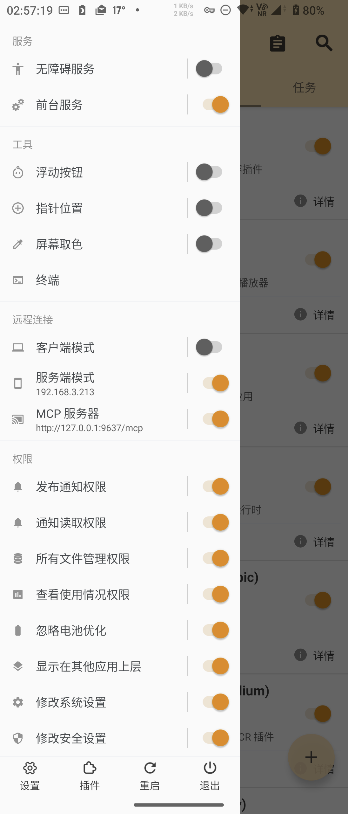
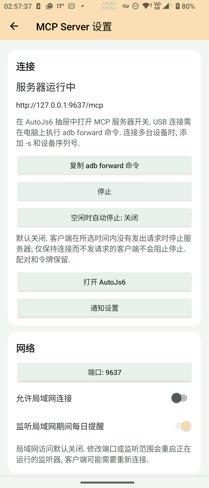

<!--suppress HtmlDeprecatedAttribute, HttpUrlsUsage -->

<div align="center">
  <p>
    <picture>
      <source srcset="https://github.com/SuperMonster003/AutoJs6-Plugin-MCP-Server/blob/master/app/src/main/res/mipmap-night/ic_launcher.png?raw=true" media="(prefers-color-scheme: dark)" />
      
    </picture>
  </p>

  <p>透過 Model Context Protocol 向 AI 代理開放裝置自動化能力</p>

  <p>
    <a href="https://github.com/SuperMonster003/AutoJs6-Plugin-MCP-Server/releases"></a>
    <a href="https://github.com/SuperMonster003/AutoJs6-Plugin-MCP-Server/issues"></a>
    <a href="https://github.com/SuperMonster003/AutoJs6-Plugin-MCP-Server/blob/master/LICENSE"></a>
  </p>
</div>

******

### 語言

******

目前 README.md 支援以下語言:

- [简体中文 [zh-Hans]](https://github.com/SuperMonster003/AutoJs6-Plugin-MCP-Server/blob/master/.readme/README-zh-Hans.md)
- [繁體中文 (香港) [zh-Hant-HK]](https://github.com/SuperMonster003/AutoJs6-Plugin-MCP-Server/blob/master/.readme/README-zh-Hant-HK.md)
- 繁體中文 (台灣) [zh-Hant-TW] # 目前
- [English [en]](https://github.com/SuperMonster003/AutoJs6-Plugin-MCP-Server/blob/master/.readme/README-en.md)
- [Français [fr]](https://github.com/SuperMonster003/AutoJs6-Plugin-MCP-Server/blob/master/.readme/README-fr.md)
- [Español [es]](https://github.com/SuperMonster003/AutoJs6-Plugin-MCP-Server/blob/master/.readme/README-es.md)
- [日本語 [ja]](https://github.com/SuperMonster003/AutoJs6-Plugin-MCP-Server/blob/master/.readme/README-ja.md)
- [한국어 [ko]](https://github.com/SuperMonster003/AutoJs6-Plugin-MCP-Server/blob/master/.readme/README-ko.md)
- [Русский [ru]](https://github.com/SuperMonster003/AutoJs6-Plugin-MCP-Server/blob/master/.readme/README-ru.md)
- [العربية [ar]](https://github.com/SuperMonster003/AutoJs6-Plugin-MCP-Server/blob/master/.readme/README-ar.md)

******

### 簡介

******

MCP Server 讓執行 AutoJs6 的 Android 裝置成為一台 [Model Context Protocol](https://modelcontextprotocol.io) 伺服器. 電腦上的 AI 代理 (例如 Claude Code, Cursor 或 MCP Inspector) 透過 USB 或 Wi-Fi 連線手機, 藉由工具執行指令碼, 讀取日誌, 檢視無障礙節點樹, 點擊與輸入, 擷取螢幕, 以及操作檔案與應用程式.

伺服器在外掛自己的處理程序中執行, 透過單一的 Streamable HTTP 端點對外提供服務. AutoJs6 透過 Binder 向外掛下發能力代理, 每次工具呼叫都由主程式以其既有的權限, 引擎和無障礙服務執行; 外掛不會複製主程式的任何功能.

******

### 目前狀態

******

版本 1.2.0: 37 個工具 (預設啟用 33 個), MCP 資源與提示, AutoJs6 抽屜開關與外掛程式設定頁. 需要 AutoJs6 6.8.0 (組建 5298) 或更高版本; 可選的 autojs6://docs/ 資源還需要 AutoJs6 離線文件外掛以及帶轉讀方法的宿主. 進度與證據記錄在 [ROADMAP.md](https://github.com/SuperMonster003/AutoJs6-Plugin-MCP-Server/blob/master/ROADMAP.md).

******

### 功能

******

外掛程式提供以下能力:

- 手機設定頁提供服務狀態, USB 轉發, 連接埠與區域網路存取, 權杖顯示/複製/輪換, 配對撤銷, 工具群組與 root 權限, 開發者模式, 可複製 (也可顯示為 QR 碼) 的 Claude Code / Cursor / Codex / VS Code / 通用 HTTP 設定及發行歷史, 並跟隨 AutoJs6 外觀. 網路設定會重新啟動執行中的監聽器, 權杖與權限變更立即生效. 敏感資訊視窗禁止截圖.
- 指令碼執行: 在 AutoJs6 內執行文字或檔案形式的 JavaScript, 列出與停止引擎, 讀取最近的主控台輸出.
- 無障礙介面: 以精簡文字格式匯出節點樹, 用 AutoJs6 選擇器語法尋找節點, 點擊, 長按, 捲動, 設定文字, 以及觸發返回和主畫面等全域按鍵.
- 螢幕擷取群組 (P3.3): screen_capture 傳回 MCP 圖片, 支援裁切, scale 或 maxWidth, JPEG / PNG / WebP 與品質參數. 預設 JPEG 品質 70, 最長邊 1280 px. base64 超過 4 MiB 時降低品質或尺寸重試, 中繼資料說明調整情況. screen_state 傳回亮屏狀態, 尺寸, 方向和密度. 工具目錄現有 37 項. MediaProjection 備援需要 2026-09-13 或之後建置的 AutoJs6 主程式及手機端授權, 主程式工作階段重用該授權. annotate: true 時在螢幕截圖上標出最近一次 ui_dump 的 #n 編號 (每個節點一個邊框和標籤), 方便把編號與畫面對應.
- 工作目錄工具 (P3.4): files_list / stat / read / write / mkdir / rename / delete, 使用從 1 開始的行列號的 editor_open, app_launch / list, clipboard_get / set, device_ensure_accessibility, toast 和 shell_exec. 二進位讀取使用 base64, 原始資料最多 1 MiB. 寫入亦受宿主請求預算約束 (通常為包含 JSON 跳脫的 96 KiB). 檔案刪除和 Shell 預設關閉; root 另需 allowShellRoot 開關與宿主 shell.root 授權. 這些能力需要相符的 P3.4 宿主建置.
- MCP 資源 (P3.5) 提供唯讀工作目錄檔案, 可瀏覽的宿主範例, 安裝 AutoJs6 離線文件外掛後的離線文件, 裝置資訊和最近主控台輸出, 遵守配對與分組開關. 文字和二進位讀取報告截斷狀態. write_autojs6_script, automate_task 和 debug_selector 提示提供中英文指引, 其他手機語言回退英語.
- 連線方式: 透過 `adb forward` 的 USB 連線, 須明確開啟的區域網路連線, 以及面向無 HTTP 傳輸用戶端的電腦端 stdio 橋接程式.
- 安全: 可輪換的 Bearer 權杖, 手機端首次配對確認, 依分組的工具開關; 伺服器預設只監聽回送介面.

******

### 工具清單

******

下表由外掛程式的工具目錄快照 (`app/src/test/resources/tool-catalog.snapshot.json`) 產生; 描述為用戶端收到的英文原文, 每個分組都可在設定頁關閉:

| 工具 | 分組 | 預設 | 描述 |
|---|---|---|---|
| `device_ping` | `device` | 開 | Confirms that the AutoJs6 MCP Server plugin is reachable and returns its version, the device model, the Android API level, and the device time. |
| `device_info` | `device` | 開 | Returns the device build, screen, battery, memory, AutoJs6 host version and process, accessibility service state, screen state, locale, and time zone as AutoJs6 reports them (schema autojs6-bridge-device-info-v1). No hardware identifiers. With AutoJs6 6.8.0 or later, plugins lists the plugin families (OCR, barcode, OpenCV, Pinyin, Pinyin4j, MediaInfo, offline docs) as available, not_installed, disabled or incompatible, the tools each brings and what to do in the AutoJs6 plugin center, so you can tell the user which plugin to install. |
| `script_run` | `script` | 開 | Runs JavaScript source in AutoJs6 (its Rhino engine with the full AutoJs6 API) and by default waits for it to finish. Use it for automation steps: toasts, UI actions, file work, app launches. The result carries executionId, status (finished, error, running), durationMs, the exception with its line when the script threw, and the newest console lines. A script still running after the wait keeps running: script_stop stops it, script_list shows it, console_tail follows its output. |
| `script_run_file` | `script` | 開 | Runs a script file that already exists on the device (AutoJs6 picks the engine from the suffix) and by default waits for it to finish. The result carries executionId, status (finished, error, running), durationMs, the exception with its line when the script threw, and the newest console lines. A script still running after the wait keeps running: script_stop stops it, script_list shows it, console_tail follows its output. |
| `script_stop` | `script` | 開 | Stops one running AutoJs6 script by the executionId that script_run, script_run_file, or script_list reported. |
| `script_stop_all` | `script` | 開 | Stops every script AutoJs6 is running, including ones started on the phone, and returns how many were stopped. |
| `script_list` | `script` | 開 | Lists the scripts AutoJs6 is running or starting, with executionId, name, path, working directory, state, and uptime. |
| `console_tail` | `script` | 開 | Returns the newest lines of the AutoJs6 console, which every script shares; optionally only entries after sinceId or at least a level. nextSinceId in the result continues from where this call ended. |
| `script_catalog` | `script` | 開 | Lists the scripts the user registered for models in the AutoJs6 working directory (a script with an @agent JSDoc header, or a project with an agent object in project.json): id, path, description, parameter schema, the result it reports, risk (readonly, normal, sensitive), confirm (never, before-run) and timeout. query filters by id, description, tags and examples. Run one with script_registered_run; before running a script whose confirm is before-run or whose risk is sensitive, ask the user. Needs AutoJs6 6.8.0 or later. |
| `script_registered_run` | `script` | 開 | Runs a script from script_catalog with arguments that AutoJs6 checks against the script's registered parameters (defaults filled in, unknown names refused), waits for it and stops it after its registered timeout (timeoutMs may only shorten it). Give id, or path when several scripts share an id. Returns the status (finished, error, stopped, timeout), the value the script reported with ai.agent.result, and the newest console lines. A registered script can act on the phone like script_run; ask the user first when its catalog entry says confirm before-run or risk sensitive. Needs AutoJs6 6.8.0 or later. |
| `ui_dump` | `ui` | 開 | Dumps the accessibility node tree of the active window as compact text: one node per line with a #n reference, an indent per depth, the short class name, the state markers that apply (clickable, long_clickable, checkable, checked, scrollable, editable, focused, selected, !enabled, hidden), the text in quotes, desc=, id= (the full resource id), and the position (bounds [l,t][r,b] for a node with children, c=(x,y) for a leaf). Pass a #n reference as nodeRef to ui_click, ui_long_click, ui_set_text, or ui_scroll: AutoJs6 keeps the newest 8 dumps (snapshotId) and finds the node again when acting, so a reference works until the window changes or the node moves or changes. Call it before acting and again after the screen changed. format json returns the nodes as objects with every flag and format xml the uiautomator-style export; neither has references. |
| `ui_find` | `ui` | 開 | Finds the nodes of the active window that match every condition of the selector, optionally waiting up to timeoutMs for the first match, and returns up to limit of them with bounds, center, and a selector that pins each node (pass it as selector to the action tools). An empty count is not an error; ui_explain_selector tells which condition fails. |
| `ui_current_window` | `ui` | 開 | Returns the package and activity in the foreground, whether the AutoJs6 accessibility service is available, and the accessibility windows with their type, title, bounds, and focus. |
| `ui_explain_selector` | `ui` | 開 | Explains why a selector matches or not: evaluates its conditions one by one over the active window and reports how many nodes pass each step cumulatively, the first failing condition, the matches, and the near misses. Use it when ui_find returns nothing. |
| `ui_wait_for` | `ui` | 開 | Waits until a node matching the selector appears (default) or disappears, polling the active window every 0.5 s for up to timeoutMs, and answers TIMEOUT when the state is not reached; an appeared node comes with a selector that pins it. Use it after an action that opens a screen or dismisses a dialog. |
| `ui_click` | `ui` | 開 | Clicks a node given by nodeRef (a #n reference from the last ui_dump), by selector (the first match in pre-order), or by x and y (a coordinate tap, allowed only while the ui_gesture group is enabled). The accessibility click climbs to the nearest clickable ancestor when the node itself is not clickable. Returns the node it acted on. Give nodeRef or selector, not both. |
| `ui_long_click` | `ui` | 開 | Long-presses a node given by nodeRef or selector (the accessibility long click climbs to the nearest node that accepts it), or by x and y as a 700 ms press at that point (allowed only while the ui_gesture group is enabled). Give nodeRef or selector, not both. |
| `ui_set_text` | `ui` | 開 | Sets the text of an editable node (an EditText, marked editable by ui_dump) given by nodeRef or selector; append adds to the current text instead of replacing it and needs a selector. Works without focus or the keyboard; ACTION_FAILED means the node is not editable or not enabled. Give nodeRef or selector, not both. |
| `ui_scroll` | `ui` | 開 | Scrolls a node given by nodeRef or selector, or the first scrollable node of the window when neither is given: forward, down, and right move towards the end, backward, up, and left towards the start; times repeats the step. performed counts the steps the node accepted, fewer than requested means it reached the end. Give nodeRef or selector, not both. |
| `ui_press_key` | `ui` | 開 | Presses a global key through the accessibility service: back, home, recents, notifications (opens the notification shade), quick_settings, power_dialog, or lock_screen (Android 9 or later). |
| `ui_swipe` | `ui_gesture` | 關 | Swipes one finger from (x1, y1) to (x2, y2) in device pixels over durationMs; take the coordinates from ui_dump bounds or a screenshot. Part of the ui_gesture group, which is off by default. |
| `ui_gesture` | `ui_gesture` | 關 | Performs a free-path one-finger gesture through the given points over durationMs (at most 10 s): the first point is the touch down, the last the lift. Part of the ui_gesture group, which is off by default. |
| `screen_capture` | `screen` | 開 | Capture the phone screen as an MCP image with dimensions, size, duration and capture source. Uses accessibility on Android 11+ and falls back to MediaProjection, which requires consent on the phone the first time. Defaults to JPEG quality 70 and a longest edge of 1280 pixels. Choose scale or maxWidth to override the size. Images above the 4 MiB base64 limit are retried at lower quality or smaller dimensions; metadata reports adjustments. With annotate the #n references of the newest ui_dump are drawn on the image. At most 30 captures per minute per client; a RATE_LIMITED result names the wait in retryAfterMs. |
| `screen_state` | `screen` | 開 | Read whether the screen is on, its current width and height, orientation, rotation, and density. Does not request screen capture consent. |
| `files_list` | `files` | 開 | Lists workspace files with metadata. Results are bounded and report truncation. While "Allow reading shared storage" is switched on in the MCP Server settings on the phone, absolute paths in shared storage (such as /storage/emulated/0/DCIM/...) are accepted too, read-only; Android/data and Android/obb never are. A shared storage listing answers absolute paths and its root. |
| `files_stat` | `files` | 開 | Returns existence, type, size, and modification time of a workspace path. While "Allow reading shared storage" is switched on in the MCP Server settings on the phone, absolute paths in shared storage (such as /storage/emulated/0/DCIM/...) are accepted too, read-only; Android/data and Android/obb never are. |
| `files_read` | `files` | 開 | Reads up to 1 MiB. Use encoding base64 for binary data; encoding, bytes, totalBytes, and truncated identify the representation and limit. |
| `files_write` | `files` | 開 | Writes UTF-8 text and refreshes the host explorer. Content is limited to 1 MiB and the negotiated Binder request budget (normally 96 KiB including JSON escaping); oversized calls fail before writing. |
| `files_mkdir` | `files` | 開 | Creates a workspace directory and missing parents, then refreshes the host explorer. |
| `files_rename` | `files` | 開 | Moves a workspace file or directory to another workspace path and refreshes the host explorer. |
| `files_delete` | `files_delete` | 關 | Deletes a workspace entry. The separate files_delete group is off by default. The workspace root cannot be deleted. |
| `editor_open` | `files` | 開 | Opens a workspace file in the AutoJs6 editor at a one-based line and column. Lines outside the file are ignored by the editor. |
| `app_launch` | `device` | 開 | Opens an installed Android application. Provide exactly one of packageName or appName. |
| `app_list` | `device` | 開 | Lists up to 1000 Android applications visible to AutoJs6, optionally matching a package name or label. Android package visibility restrictions apply. |
| `clipboard_get` | `device` | 開 | Reads clipboard text (up to 64 KiB). Android may restrict clipboard access while AutoJs6 is in the background. |
| `clipboard_set` | `device` | 開 | Replaces clipboard text, including an empty string to clear it. |
| `device_ensure_accessibility` | `device` | 開 | Asks AutoJs6 to enable its accessibility service using its configured secure-settings, root, or Shizuku strategy. Waits up to 10 s for an operational service; failure includes manual activation guidance. |
| `toast` | `device` | 開 | Shows a short Android toast on the phone. |
| `shell_exec` | `shell` | 關 | Runs an Android shell command in the host workspace. The shell group is off by default; root also requires the separate allow root switch and a shell.root host grant. Reports exit code, timeout, stdout, stderr, and truncation. maxOutputBytes bounds stdout and stderr together. |
| `ocr_recognize` | `ocr` | 開 | Recognize text on the phone screen or in an image file on the phone with an installed AutoJs6 OCR plugin (ML Kit, Paddle OCR or Rapid OCR). image is "screen" for the current screen, or a POSIX path relative to the AutoJs6 working directory for an image file. region crops before recognition, in screen pixels or file pixels. engine picks the OCR plugin; auto takes the first enabled one in ML Kit, Paddle, Rapid order. Returns the recognized lines as text and, as structured content, items with text, confidence and bounds (file bounds are in the file's own pixels even when AutoJs6 downscaled the image to read it). The screenshot is taken and recognized inside AutoJs6; no image leaves the phone. A first Paddle call loads its model and can take tens of seconds; timeoutMs defaults to 60 s. This tool exists only while an OCR plugin is installed and enabled in AutoJs6. While "Allow reading shared storage" is switched on in the MCP Server settings on the phone, absolute paths in shared storage (such as /storage/emulated/0/DCIM/...) are accepted too, read-only; Android/data and Android/obb never are. Reading the screen counts against the limit of 30 screenshots per minute per client that screen_capture also uses. |
| `barcode_detect` | `barcode` | 開 | Detect barcodes and QR codes on the phone screen or in an image file on the phone with the AutoJs6 ML Kit Barcode plugin. image is "screen" for the current screen, or a POSIX path relative to the AutoJs6 working directory for an image file. formats limits the symbologies (all by default); region crops before detection, in screen pixels or file pixels. Returns one line per code (format and raw value) and, as structured content, items with rawValue, displayValue, format, valueType, bounds and cornerPoints (file coordinates are in the file's own pixels even when AutoJs6 downscaled the image to read it). The screenshot stays inside AutoJs6; no image leaves the phone. This tool exists only while the barcode plugin is installed and enabled in AutoJs6. While "Allow reading shared storage" is switched on in the MCP Server settings on the phone, absolute paths in shared storage (such as /storage/emulated/0/DCIM/...) are accepted too, read-only; Android/data and Android/obb never are. Reading the screen counts against the limit of 30 screenshots per minute per client that screen_capture also uses. |
| `opencv_find_image` | `opencv` | 開 | Find where a smaller template image appears on the phone screen or in an image file on the phone (OpenCV template matching through the AutoJs6 OpenCV plugin). image is "screen" for the current screen, or a POSIX path relative to the AutoJs6 working directory; template is the path of the image to look for, at the same pixel scale as image (for the screen, cut from a full-resolution screenshot). threshold is the lowest similarity accepted (0..1); region limits the search, in screen pixels or file pixels; maxResults caps the matches, best first and without overlaps. Returns bounds, center and score of each match; screen coordinates are device pixels. This tool exists only while the OpenCV plugin is installed and enabled in AutoJs6. While "Allow reading shared storage" is switched on in the MCP Server settings on the phone, absolute paths in shared storage (such as /storage/emulated/0/DCIM/...) are accepted too, read-only; Android/data and Android/obb never are. Reading the screen counts against the limit of 30 screenshots per minute per client that screen_capture also uses. |
| `opencv_find_color` | `opencv` | 開 | Find the first pixel of a color on the phone screen or in an image file on the phone (AutoJs6 OpenCV plugin). image is "screen" for the current screen, or a POSIX path relative to the AutoJs6 working directory. color is #RRGGBB or #RGB; threshold is the difference allowed in each of the red, green and blue channels; region limits the search, in screen pixels or file pixels. Pixels are searched row by row from the top left. Returns found and the point; screen coordinates are device pixels. This tool exists only while the OpenCV plugin is installed and enabled in AutoJs6. While "Allow reading shared storage" is switched on in the MCP Server settings on the phone, absolute paths in shared storage (such as /storage/emulated/0/DCIM/...) are accepted too, read-only; Android/data and Android/obb never are. Reading the screen counts against the limit of 30 screenshots per minute per client that screen_capture also uses. |
| `opencv_find_multi_colors` | `opencv` | 開 | Find the first point whose color matches and whose neighbors at given offsets match their colors too (multi-point color search, AutoJs6 OpenCV plugin), on the phone screen or in an image file on the phone. image is "screen" for the current screen, or a POSIX path relative to the AutoJs6 working directory. color is the color of the point itself (#RRGGBB or #RGB); points lists the neighbors as {x, y, color}, with x and y relative to that point in the pixels of image. threshold is the difference allowed in each RGB channel for color and the average difference allowed for the neighbors; region limits where the point may lie. Returns found and the point; screen coordinates are device pixels. This tool exists only while the OpenCV plugin is installed and enabled in AutoJs6. While "Allow reading shared storage" is switched on in the MCP Server settings on the phone, absolute paths in shared storage (such as /storage/emulated/0/DCIM/...) are accepted too, read-only; Android/data and Android/obb never are. Reading the screen counts against the limit of 30 screenshots per minute per client that screen_capture also uses. |
| `pinyin_convert` | `pinyin` | 開 | Convert Chinese text to Hanyu Pinyin with the AutoJs6 Pinyin plugin, which reads whole words from a phrase dictionary, so a character with several readings usually gets the one its word needs ("银行" -> yín háng); segment (on by default) splits longer text into words before the lookup. Readings come from the dictionary, so names and rare words can differ from usage. style picks the output (tone marks by default, tone2 / to3ne with digits, normal without tones, initials, first_letter); mode surname or place_name uses the readings of names; heteronym lists every reading of each character. Returns the pinyin as text, readings joined by spaces and alternatives by \|, and the rows as structured content. For other romanizations (Wade-Giles, Yale, ...) or the readings of single characters use pinyin4j_convert. This tool exists only while the Pinyin plugin is installed and enabled in AutoJs6. |
| `pinyin4j_convert` | `pinyin4j` | 開 | Romanize Chinese text character by character with the AutoJs6 Pinyin4j plugin. Unlike pinyin_convert it looks at each character alone, without word context, so a character with several readings gets its first dictionary reading; in return it offers other romanizations (romanization: hanyu, tongyong, wade_giles, mps2, yale, gwoyeu) and, with allReadings, every reading of each character. For hanyu, tone chooses tone marks (default), tone numbers or none, and case lower or upper; other romanizations do not take tone or case. Returns the readings joined by separator (a space by default) as text, and one row per character as structured content. This tool exists only while the Pinyin4j plugin is installed and enabled in AutoJs6. |
| `mediainfo_read` | `mediainfo` | 開 | Read the technical details and tags of an audio, video or image file on the phone with the AutoJs6 MediaInfo plugin: container format, duration, bit rates, codecs, resolution, frame rate, channels, sampling rate, title, artist and more. path is a POSIX path relative to the AutoJs6 working directory. Returns one summary line per track as text and every field of every track (general, video, audio, text, image, menu, other) as structured content; report adds the full MediaInfo text report. Values are MediaInfo's display strings ("5 min 3 s", "1 920 pixels"). This tool exists only while the MediaInfo plugin is installed and enabled in AutoJs6. While "Allow reading shared storage" is switched on in the MCP Server settings on the phone, absolute paths in shared storage (such as /storage/emulated/0/DCIM/...) are accepted too, read-only; Android/data and Android/obb never are. |

******

### 使用方式

******

1. 在安裝了 AutoJs6 組建 5298 (6.8.0) 或更新版本的裝置上, 從 [Releases](https://github.com/SuperMonster003/AutoJs6-Plugin-MCP-Server/releases) 下載並安裝外掛 APK.
2. 開啟 AutoJs6 外掛中心, 確認 `MCP Server` 已被辨識並啟用. 官方發行套件會自動通過簽章驗證.
3. 在 AutoJs6 抽屜中開啟 MCP 伺服器. 長按項目標題或點選外掛程式中心的設定入口, 進入設定頁並複製電腦用戶端所需設定.
4. 在電腦上執行 `adb forward tcp:9637 tcp:9637`, 並讓 MCP 用戶端連線 `http://127.0.0.1:9637/mcp`, 以權杖作為 Bearer 憑證.
5. 首次連線時在手機上確認配對要求. 使用完畢後可從抽屜, 設定頁或通知中停止服務.

> MCP 伺服器抽屜開關提供安裝, 啟用, 授權與相容性引導, 與通知停止操作同步, 重新連線時保留外掛程式設定, 抽屜及外掛程式中心透過權限檢查開啟同一設定頁. AutoJs6 開啟時恢復先前啟用的伺服器, 但遵循宿主離線期間的使用者停止操作, 不隨裝置開機自啟.

<p align="center">
  
  
</p>

******

### 用戶端設定

******

Claude Code 只需一道命令即可註冊伺服器; 其他用戶端在各自的 MCP 設定中使用相同的 URL 與請求標頭:

```shell
adb forward tcp:9637 tcp:9637
claude mcp add --transport http autojs6 http://127.0.0.1:9637/mcp --header "Authorization: Bearer <token>"
```

在 AutoJs6 抽屜中開啟 MCP 伺服器. 長按項目標題或點選外掛程式中心的設定入口, 進入設定頁並複製電腦用戶端所需設定. 首次連線時在手機上確認配對要求. 使用完畢後可從抽屜, 設定頁或通知中停止服務.

******

### 連線路徑

******

USB: `adb forward tcp:9637 tcp:9637` 將手機連接埠對應到 PC; 多台裝置時加上 `-s <serial>` (透過 `adb devices` 查看), 模擬器同樣適用. 任一側連接埠被占用時, 在設定頁修改連接埠並轉送新連接埠. 連線卡片提供可直接複製的轉送命令.

區域網路: 在設定頁開啟 "允許區域網路連線". 設定頁隨後列出手機目前位址 (隨 Wi-Fi 變化重新整理) 並提示用戶端需處於同一網路; 訪客網路, AP 隔離和 PC 防火牆是常見阻礙. 來自區域網路的配對要求會被顯著標註; 伺服器持續可從網路存取期間每日通知提醒, 提醒可關閉. 在 Android 17 以上, 在 AutoJs6 外掛程式中心啟用此外掛程式前須允許存取附近的裝置. 也可在此外掛程式的設定頁面管理區域網路權限. 未獲授權時外掛程式保持關閉, 自動啟動將靜默略過. 此權限屬於外掛程式本身, 與 AutoJs6 的授權相互獨立.

兩條路徑使用相同的權杖和相同的手機側配對. 沒有 HTTP 傳輸的用戶端使用 "接入" 中介紹的 stdio 橋接程式.

******

### 接入

******

設定頁會為下列每個用戶端複製帶真實權杖的現成設定; 此處的片段以 `<token>` 作為占位. 所有用戶端都透過帶 Authorization 標頭的 Streamable HTTP 通訊, 新用戶端的首次呼叫需在手機上確認. 已實測: Claude Code, Codex CLI, MCP Inspector, VS Code Copilot Chat, Cursor CLI 與 Claude Desktop (經橋接程式); 其餘用戶端使用相同的 URL 與標頭, 但維護者尚未測試.

Claude Code: 執行 "用戶端設定" 中的命令 (設定頁複製的版本已帶權杖); 隨後 `claude mcp list` 會將 `autojs6` 顯示為 Connected.

Cursor: 將下面的條目加入 `mcp.json` (Cursor CLI `cursor-agent` 讀取同一個 `~/.cursor/mcp.json`):

```json
{
  "mcpServers": {
    "autojs6": {
      "url": "http://127.0.0.1:9637/mcp",
      "headers": {
        "Authorization": "Bearer <token>"
      }
    }
  }
}
```

VS Code (Copilot Chat): 執行 `MCP: Open User Configuration` 指令, 把下面的內容合併進開啟的 `mcp.json`; 頂層鍵是 `servers` 而不是 `mcpServers`, 所以通用 JSON 片段不能原樣使用. 首次啟動伺服器時 VS Code 會提示輸入權杖並保存在其密鑰儲存區中, 權杖不寫入檔案 (設定頁 "VS Code mcp.json" 對話方塊的 "複製權杖" 按鈕可複製權杖):

```json
{
  "inputs": [
    {
      "type": "promptString",
      "id": "autojs6-token",
      "description": "AutoJs6 MCP Server token",
      "password": true
    }
  ],
  "servers": {
    "autojs6": {
      "type": "http",
      "url": "http://127.0.0.1:9637/mcp",
      "headers": {
        "Authorization": "Bearer ${input:autojs6-token}"
      }
    }
  }
}
```

Codex CLI: 將權杖放入環境變數 `AUTOJS6_MCP_TOKEN` (設定頁可複製對應的 PowerShell 命令), 再把伺服器加入 `config.toml`, 或執行 `codex mcp add autojs6 --url <url> --bearer-token-env-var AUTOJS6_MCP_TOKEN`:

```toml
[mcp_servers.autojs6]
url = "http://127.0.0.1:9637/mcp"
bearer_token_env_var = "AUTOJS6_MCP_TOKEN"
```

MCP Inspector: CLI 模式無需額外設定, Web 介面透過自帶的 Node 代理存取手機. 僅當瀏覽器頁面直接連線端點時, 才需在設定頁開啟開發者模式:

```shell
npx @modelcontextprotocol/inspector --cli http://127.0.0.1:9637/mcp --transport http --header "Authorization: Bearer <token>" --method tools/list
```

Cline, Gemini CLI 等用戶端: 在各自的 MCP 設定中使用相同的 URL 與標頭; 設定頁提供帶 `"type": "http"` 的通用 JSON 片段 (頂層鍵為 `mcpServers`).

Claude Desktop 及其他只支援 stdio 的用戶端: 用 `npm install -g autojs6-mcp-bridge` 安裝橋接程式, 將 `autojs6-mcp-bridge --serial <serial>` 註冊為 stdio 伺服器並把 `AUTOJS6_MCP_TOKEN` 放入其環境變數區塊 (Claude Desktop 與 Claude Code 的片段見[橋接程式 README](https://github.com/SuperMonster003/AutoJs6-MCP-Bridge)). 橋接程式 0.1.1 (需要 Node.js 22 或更新版本) 適用於外掛 1.0.1 以上版本, 透傳用戶端的協定版本, 手機監聽器重新啟動後會自動開啟新的工作階段 (0.1.0 適用 Node.js 18 或更新版本, 此時需要在用戶端重新啟動該伺服器); 已用 Claude Code 2.1.257 與 Claude Desktop 2.9939 經 stdio 驗證. Windows 上可直接用 `node` 執行全域安裝目錄中的 `autojs6-mcp-bridge/dist/cli.js`, 比經 `npx` 啟動更穩定.

******

### 常見問題

******

- 401 Unauthorized: 權杖缺失, 輸錯或已輪換. 從設定頁重新複製設定; 輪換權杖後每個用戶端都需要新值.
- VS Code 彈出 OAuth 或用戶端註冊提示: 權杖錯誤時 VS Code 會先嘗試 OAuth 探索與動態用戶端註冊, 而外掛只接受靜態權杖. 取消提示, 清除 VS Code 已保存的輸入值後重新輸入權杖, 再重新啟動伺服器.
- 配對逾時: 新用戶端的首次呼叫會等待約一分鐘, 直到手機上點選允許. 解鎖手機, 接受對話方塊或通知動作, 然後重複呼叫. 拒絕會進入短暫冷卻, 之後下一次呼叫會再次詢問.
- HOST_UNAVAILABLE: AutoJs6 未執行或外掛工作階段已關閉. 開啟 AutoJs6, 保持抽屜開關開啟, 並在設定頁查看連線狀態.
- 連線被拒 (`ECONNREFUSED`): 抽屜開關未開啟, 或電腦上的 `adb forward` 已失效. adb 服務重新啟動 (重新連接裝置, 或其他工具重啟了 adb) 會清空所有轉發; 重新執行 `adb -s <serial> forward tcp:9637 tcp:9637`, 或讓橋接程式用 `--serial` 自行建立轉發 (橋接程式結束時會移除該轉發).
- 無障礙未啟用: `ui_*` 工具與截圖需要 AutoJs6 無障礙服務. 呼叫 `device_ensure_accessibility`, 或在系統無障礙設定中啟用該服務.
- 連接埠被占用: 抽屜會回報 `port_in_use`. 在設定頁修改連接埠, 並用 adb 轉送新連接埠.
- 區域網路不可達: 開啟區域網路存取, 使用設定頁列出的位址, 讓 PC 與手機處於同一網路且無訪客隔離, 並在 PC 防火牆放行該連接埠. 手機 Wi-Fi 省電會使每次呼叫增加幾百毫秒.
- 熄屏後伺服器消失: 限制了本應用程式電池用量的手機 (HyperOS 與 MIUI 預設對側載應用程式如此) 會在使用電池熄屏約一分鐘後停止前景服務. 此時設定頁顯示警告和 "電池設定" 按鈕, 請在其中為 MCP Server 選擇 "無限制". 可選的 "閒置時自動停止" (預設關閉) 也會在所選分鐘數內無請求時停止伺服器, 並留下一條說明通知.
- Cursor CLI 拒絕工具呼叫: `cursor-agent` 預設只執行允許清單中的工具, 在列印模式 (`-p`) 下未放行的 MCP 工具會在本機被拒絕, 請求不會到達手機, 手機上也不會出現配對提示. 在 `~/.cursor/cli-config.json` 的 `permissions.allow` 中按工具加入 `Mcp(autojs6:<工具名稱>)`, 例如 `Mcp(autojs6:device_info)`.

******

### 權限與安全

******

外掛遵循明確的邊界:

- Binder 入口與設定頁受 `org.autojs.permission.PLUGIN` 簽章權限保護, 只有 AutoJs6 能夠存取; 配對對話框, 其接收器與發行歷史頁均未匯出. 只有承載監聽器的前景服務接受 adb (`android.permission.DUMP`), 作為開發者的啟停開關.
- INTERNET 權限僅用於外掛自身的 HTTP 監聽; 外掛不發起任何對外請求, 也不蒐集資料. 透過網路安全設定, 明文 HTTP 僅允許指向回送位址.
- 伺服器預設只監聽 127.0.0.1. 區域網路存取保持關閉直到你手動開啟; 開啟後權杖, 配對確認, Host 允許清單與速率限制在區域網路上仍然生效, 並有每日一次的通知提醒.
- 在 Android 17 以上, 在 AutoJs6 外掛程式中心啟用此外掛程式前須允許存取附近的裝置. 也可在此外掛程式的設定頁面管理區域網路權限. 未獲授權時外掛程式保持關閉, 自動啟動將靜默略過. 此權限屬於外掛程式本身, 與 AutoJs6 的授權相互獨立.
- 存取權杖來自安全隨機來源, 以 Android Keystore 中的 AES-GCM 金鑰封裝後保存在外掛私有且永不備份的儲存空間中; 備份與裝置轉移均已停用. 設定頁只顯示權杖末 4 位, 完整權杖對話框禁止截圖, 複製到剪貼簿時標記為敏感內容.
- 日誌從不包含權杖, 請求內容, 檔案內容或截圖; 外掛只記錄工具名, 用戶端名與權杖指紋. 已在兩台裝置上於真實的檔案與截圖呼叫期間用 logcat 驗證 (docs/dev/p6-security-audit.md).
- 工具呼叫經由 AutoJs6 能力代理執行, 永遠不會超出主程式自身的權限範圍; Shell 命令, 檔案刪除與手勢保持關閉直到你啟用對應分組, root Shell 還需要單獨的開關與主程式授權. 讀取共用儲存空間 (相簿, 下載等) 同樣預設關閉: 開啟 "允許讀取共用儲存空間" 後, 辨識, 媒體資訊與列出目錄 / 查看屬性工具才能唯讀存取其中的絕對路徑, Android/data 與 Android/obb 始終除外.
- 可在設定頁逐個或一次性撤銷配對; 被撤銷的用戶端在下次工具呼叫前必須重新在手機上確認. 輪換權杖會保留配對, 但仍使用舊權杖的用戶端會立即失效.

請只從官方 [Releases](https://github.com/SuperMonster003/AutoJs6-Plugin-MCP-Server/releases) 頁面或 AutoJs6 外掛中心取得外掛. 來源不明的安裝套件即使版本號相同, 也可能無法通過主程式驗證或帶來風險.

******

### 外掛介面

******

以下資訊面向 AutoJs6 主程式與外掛開發者; 主程式使用這些識別碼探索外掛並協商相容性:

```text
application id: io.github.supermonster003.autojs6.plugin.mcp.server
plugin id: mcp-server
engine: mcp-server
variant: default
service action: org.autojs.plugin.MCP_SERVER
service category: mcp-server
info action: org.autojs.plugin.INFO
aidl interface: org.autojs.plugin.mcp.server.api.IMcpServerPlugin
minimum host build: 5298 (6.8.0)
default endpoint: http://127.0.0.1:9637/mcp
```

`McpServerPluginService` 在 `:mcp_server` 程序中實作宿主 mcp-server-api 契約 `org.autojs.plugin.mcp.server.api.IMcpServerPlugin`, 回應 `org.autojs.plugin.MCP_SERVER` (category `mcp-server`). `McpServerPluginInfoService` 以 PluginInfo 回應 `org.autojs.plugin.INFO`. `WakeActivity` 供宿主啟動外掛.

******

### 路線圖

******

外掛的規劃與進度以可勾選清單的形式維護在 ROADMAP.md 中, 依階段組織並附有驗收條件與證據等級. 未勾選條目表達的是意圖而非目前能力; 歡迎透過 Issues 討論.

- [檢視 ROADMAP.md](https://github.com/SuperMonster003/AutoJs6-Plugin-MCP-Server/blob/master/ROADMAP.md)

******

### 發行歷史

******

#### v1.2.0

_2026/10/15_

- `新增` 6 個外掛程式工具群組開關 (OCR 文字辨識, 條碼辨識, OpenCV 找圖找色, Pinyin 與 Pinyin4j 拼音轉換, MediaInfo 媒體資訊): 這些群組的工具只在對應的 AutoJs6 外掛程式已安裝並啟用時出現在用戶端的工具清單中, 安裝, 解除安裝或更新外掛程式後清單自動更新, 呼叫外掛程式缺失的工具會說明原因 (PLUGIN_UNAVAILABLE); 讀取螢幕的辨識呼叫 (image 為 "screen") 與 screen_capture 共用每個用戶端每分鐘 30 次的截圖上限, 辨識手機上的圖片檔案不計入
- `新增` ocr_recognize 工具, 用於辨識手機螢幕或手機上圖片檔案中的文字 (需要已安裝並啟用 ML Kit, Paddle OCR 或 Rapid OCR 外掛程式): image 為 "screen" 時在 AutoJs6 內截圖並辨識, 為工作目錄內的路徑時讀取檔案後辨識; 可選 region 裁切與 engine 指定引擎 (預設自動選擇); 結果附文字, 信心值與座標 (大圖按原圖像素回傳), 圖片不離開手機
- `新增` barcode_detect 工具, 用於辨識手機螢幕或手機上圖片檔案中的條碼與 QR Code (需要已安裝並啟用 ML Kit Barcode 外掛程式): image 為 "screen" 時在 AutoJs6 內截圖後辨識, 為工作目錄內的路徑時讀取檔案後辨識; 可選 formats 限定條碼類型, region 裁切與 maxResults 數量上限; 結果附內容, 條碼類型與座標 (大圖按原圖像素回傳), 圖片不離開手機
- `新增` opencv_find_image, opencv_find_color 與 opencv_find_multi_colors 工具, 用於在手機螢幕或手機上的圖片檔案中找圖, 找色與多點找色 (需要已安裝並啟用 OpenCV 外掛程式): 找圖的範本是工作目錄內的圖片, 結果附每處相符的範圍, 中心與相似度; 找色回傳第一個相符的像素座標; 皆可用 region 限定範圍, 圖片不離開手機
- `新增` pinyin_convert 與 pinyin4j_convert 工具, 用於把中文轉換為拼音 (分別需要已安裝並啟用 Pinyin 與 Pinyin4j 外掛程式): pinyin_convert 依詞典整詞取音, 破音字通常讀對, 可選聲調樣式, 首字母與姓名 / 地名模式; pinyin4j_convert 逐字轉換, 支援威妥瑪, 耶魯等其他拼寫方式, 聲調符號 / 數字與大寫, 並可列出每個字的全部讀音
- `新增` mediainfo_read 工具, 用於讀取手機上音訊, 影片或圖片檔案的格式, 長度, 位元率, 編碼, 解析度, 聲道, 取樣率與標籤等資訊 (需要已安裝並啟用 MediaInfo 外掛程式): 路徑為工作目錄內的檔案, 結果附每條軌道的摘要與全部欄位, 可選附上完整文字報告
- `新增` 設定頁 "允許讀取共用儲存空間" 開關 (預設關閉), 用於讓辨識, 媒體資訊與列出目錄 / 查看屬性工具唯讀存取共用儲存空間中的絕對路徑 (例如相簿與下載資料夾): 開啟前絕對路徑一律被拒絕, Android/data 與 Android/obb 始終無法讀取, 其他檔案工具仍只能存取工作目錄 (AutoJs6 需要所有檔案存取權限)
- `新增` script_catalog 與 script_registered_run 工具 (script 分組), 用於列出並執行使用者在 AutoJs6 工作目錄中為模型登記的指令碼 (帶 @agent 註解標頭的指令碼或 project.json 含 agent 的專案, 需要 AutoJs6 6.8.0 及以上): 目錄列出每個指令碼的說明, 參數, 風險等級與是否需要先確認; 執行時由 AutoJs6 依登記的參數檢查引數並補上預設值, 超過登記的時長自動停止, 回傳指令碼回報的結果與最新的主控台輸出; 只在 AutoJs6 授予對應能力時出現在工具清單中, 執行標記為敏感或需確認的指令碼前模型會先徵求使用者同意
- `修復` 實機取證指令碼在正式版旁留有偵錯測試套件時誤啟動測試並導致應用程式程序崩潰的問題
- `優化` device_info 工具與資源 autojs6://device/info 新增 plugins 欄位 (AutoJs6 6.8.0 及以上): 列出 OCR, 條碼, OpenCV, 拼音, Pinyin4j, MediaInfo 與離線文件等外掛程式家族的狀態 (可用 / 未安裝 / 已停用 / 版本不相容), 各自帶來的工具與安裝提示, 方便模型提示使用者到外掛程式中心安裝
- `優化` AutoJs6 6.8.0 建置 5333 以上時, 設定頁的通知關閉提示會說明配對請求在 AutoJs6 位於前景時同樣會出現

#### v1.1.0

_2026/10/11_

- `提示` 需要 AutoJs6 6.8.0 建置 5298 以上 (先前為 5279), 因為節點編號改由 AutoJs6 維護
- `提示` ui 工具的行為變化: ui_find 與 ui_wait_for 為每個節點傳回選擇器而非 #n 編號, ui_dump 的 json 與 xml 格式不含編號, ui_set_text 的 append 需要使用選擇器, ui_dump 顯示完整的資源 id
- `修復` 設定頁與發行歷史頁的狀態列在 Android 15 以上版本未跟隨主題色 (僅標題列著色) 的問題
- `修復` Android 14 以上版本未允許通知時, 來自電腦的配對請求在手機上可能完全看不到的問題 (現在開啟設定頁會顯示待確認的請求並提示通知已關閉)
- `優化` AutoJs6 透過與其他外掛共用的能力介面連接本外掛 (MCP 契約版本 2)
- `優化` ui_dump 的 #n 編號改由 AutoJs6 保存, 操作時由 AutoJs6 重新定位節點: 只要視窗和節點未變, 編號就持續有效 (不再 60 秒過期), 可透過 snapshotId 使用最近 8 次 dump, 編號失效時會說明原因
- `相依性` 更新 AutoJs6 外掛介面檔案至主程式建置 6.8.0/5329, 並附加 host-capability-api 本機模組 (MPL 2.0, 鎖定檔案雜湊)

#### v1.0.3

_2026/10/11_

- `新增` 設定頁用戶端設定提供 VS Code mcp.json 片段, 權杖由 VS Code 在首次啟動伺服器時提示輸入, 不寫入設定檔 (對話方塊提供 "複製權杖" 按鈕)
- `新增` 設定頁的用戶端設定片段與權杖對話框可顯示 QR 碼, 內容與 "複製" 按鈕複製的文字相同 (含權杖時一併包含, 視窗禁止截圖)
- `新增` screen_capture 的 annotate 參數, 用於在螢幕截圖上標出最近一次 ui_dump / ui_find 的 #n 編號 (邊框與標籤), 結果的 annotation 欄位回報繪製數量
- `優化` 有狀態 MCP 端點的事件串流支援斷線續傳: 事件帶 id, 協定 2025-11-25 以上版本的用戶端先收到帶重連間隔的 priming 事件, 中斷的請求串流可憑 Last-Event-ID 經 GET 接回, 補發錯過的事件與最終結果 (每個工作階段有界保留)
- `優化` device_info, screen_state, script_run 與 script_run_file 宣告輸出 schema (outputSchema), 用戶端可據此驗證結構化結果; 這些工具的錯誤結果只以文字提供錯誤碼與說明
- `優化` 外掛程式中心圖示採用統一工作台調整後的尺寸, 位置, 明暗圖稿與圓形底色, 保留可重建原稿和參數
- `優化` Android 系統應用程式資訊圖示與圖示工作台共用圖稿及明暗底色, 保留外掛程式中心透明圖稿與現有啟動器選項
- `相依性` 附加 ZXing Core 版本 3.5.4, 用於設定頁 QR 碼的產生 (僅編碼器, Apache 2.0)

##### 更多發行歷史

* [CHANGELOG.md](https://github.com/SuperMonster003/AutoJs6-Plugin-MCP-Server/blob/master/app/src/main/assets/doc/CHANGELOG-zh-Hant-TW.md)

******

### 建置與驗證

******

本節面向希望從原始碼建置外掛的開發者; 一般使用者直接安裝 Releases 頁面的預建 APK 即可.

建置 Debug APK:

```powershell
.\gradlew.bat :app:assembleDebug
```

執行 JVM 單元測試並建置 instrumentation 測試 APK:

```powershell
.\gradlew.bat :app:testDebugUnitTest :app:assembleDebugAndroidTest
```

建置 Release APK:

```powershell
.\gradlew.bat :app:assembleRelease
```

收集發行產物並在檔案名稱後附加版本與 CRC32 摘要:

```powershell
.\gradlew.bat :app:appendDigestToReleasedFiles
```

驗證多語言文件來源與產生的產物是否同步 (CI 同樣執行此檢查):

```powershell
py .python\generate_markdown.py --check
```

建置需要 JDK 21 或更新版本以及 Android SDK 37; Gradle 與外掛版本由 `version.properties` 和 `io.github.supermonster003.autojs6-platform-versions` 統一管理.

******

### 在地化與文件產生

******

```text
.readme/common.json
.readme/lang_*.json
.readme/template_readme.md
.readme/template_plugin_instruction.md
.changelog/lang_*.json
.changelog/template_changelog.md
.python/generate_markdown.py
app/src/main/assets/doc/CHANGELOG-*.md
app/src/main/res/raw-*/plugin_instruction.md
```

`.readme/` 與 `.changelog/` 下的語言 JSON 檔案是 README, 外掛中心說明與更新日誌的唯一文案來源. 請始終修改這些 JSON 來源檔案並重新執行 `py .python/generate_markdown.py`; 產生的 README, `plugin_instruction.md` 與更新日誌產物不得手動編輯. 執行 `py .python/generate_markdown.py --check` 可驗證全部產生的產物.

******

### 授權條款

******

專案程式碼基於 [Mozilla Public License 2.0](https://github.com/SuperMonster003/AutoJs6-Plugin-MCP-Server/blob/master/LICENSE) 授權. 第三方元件及其授權條款列於 [第三方聲明](https://github.com/SuperMonster003/AutoJs6-Plugin-MCP-Server/blob/master/THIRD_PARTY_NOTICES.md).

******

### 相關連結

******

- AutoJs6 專案: https://github.com/SuperMonster003/AutoJs6
- AutoJs6 文件: https://docs.autojs6.com
- Model Context Protocol 規範: https://modelcontextprotocol.io
- 第三方聲明: https://github.com/SuperMonster003/AutoJs6-Plugin-MCP-Server/blob/master/THIRD_PARTY_NOTICES.md


[16 KB page alignment and build verification](https://github.com/SuperMonster003/AutoJs6-Plugin-MCP-Server/blob/master/docs/16kb.md)
